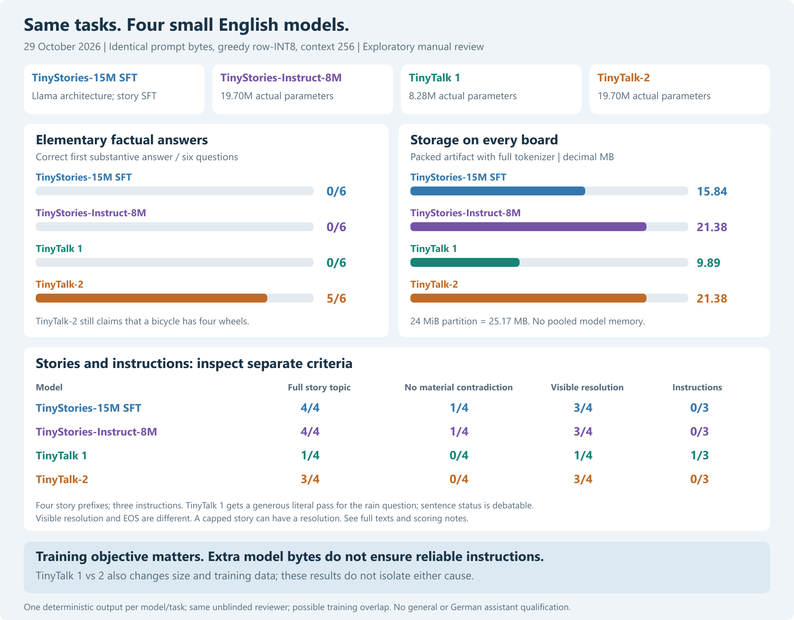
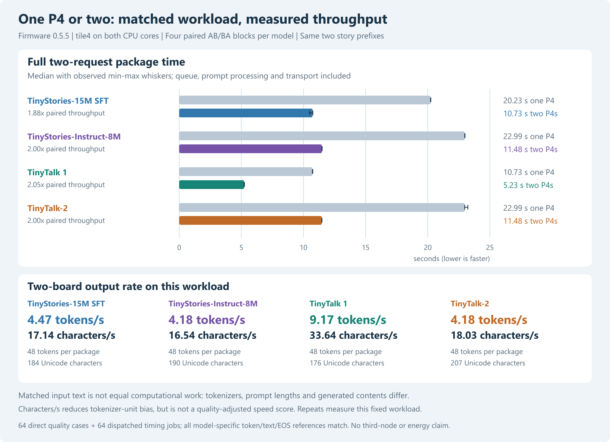
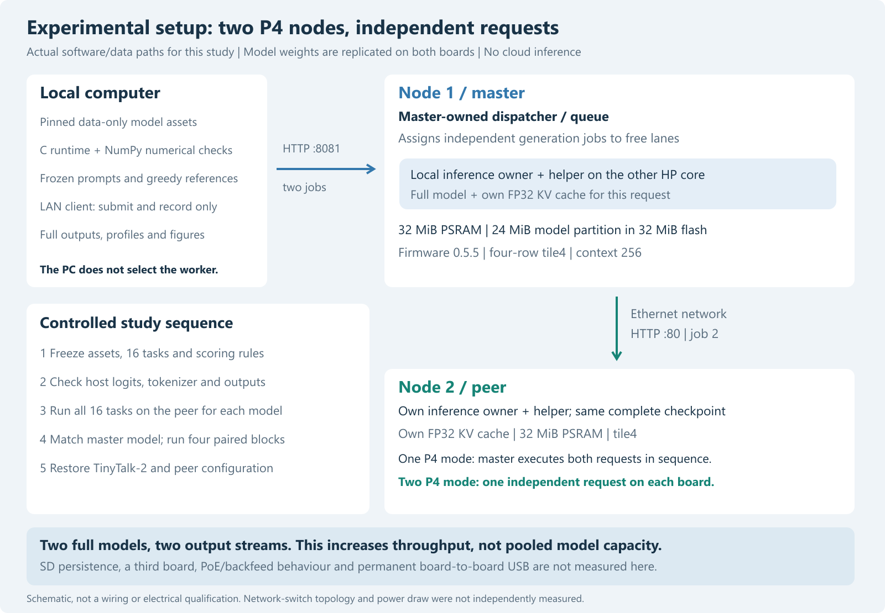

# ESP32-P4 LLM Cluster Research
## From the beginning, including the new broader quality study

[Complete project chronology](docs/CHRONOLOGY.md) ·
[new qualityV2 report](docs/quality-v2-2026-10-30.md) ·
[all48 new responses](data/quality-v2-2026-10-30/comparison.html).
Original numerical results and negative findings are retained; private data
and private Git history are excluded. Review is model-label-masked by the same
author, not independent or completely blind. See individual task/cap limits.
## Latest evidence: firmware0.9.0 and research snapshot v9

[Start with the organized evidence index](docs/RESEARCH_INDEX.md) or
[browse reports and all figures](index.html). The latest same-kernel model
comparison, INT4 production optimization and separated memory measurements are
included with raw outputs and source hashes. Source now ends at0.9.0; public
keyless diagnostic binaries still end at0.5.5. Measured private firmware images
are not distributed. See [v8 release notes](docs/RELEASE_NOTES_V9.md).

The earlier v7 status below is historical context, not the latest device/source
status. See the indexed per-study dates, firmware versions and evidence scopes.

Reproducible experiments with two Waveshare ESP32-P4-WIFI6-POE-ETH boards:
distributed text inference, Ethernet transport, autonomous job dispatch,
dual-core matrix computation, memory access, predictive simulation, and text quality.

This is a research prototype. Measurements were made on **two real boards**.
Three-node results are explicitly labelled simulations. Larger two-board model
capacity is measured in the later sharded studies; no useful general-purpose
assistant is claimed.

## New local candidate: TinyBrainBot on both P4s

Firmware0.7.0 now runs a real Metaspace/BPE tokenizer and a100M-parameter model
split across both boards. Compressed artifacts20.61/20.10MB fit the24MiB model
partitions. Thirteen real TinyBrainBot generations pass runtime reference checks;
ten retain full raw streams. LAN OTA/cold load and bounded memory tests pass.
See [the device report](docs/tinybrainbot-p4-2026-10-29.md) and
[version7 release notes](docs/RELEASE_NOTES_V7.md).

The earlier120-output [local comparison](docs/tinybrainbot-local-2026-10-29.md)
favours TinyBrainBot on a narrow factual subset; it still gives wrong facts and
fails exact instructions. Same unblinded reviewer, no general ranking.
The larger model serves one distributed lane, while earlier small-model tests
below used two independent lanes. Updated source is0.7.0; public keyless binary
bundles still end at0.5.5. Version7 is a locally prepared candidate, not uploaded.

## Main results

| Controlled experiment | Reference | Modified configuration | Interpretation |
| --- | ---: | ---: | --- |
| Initial sequential layer split, 24 tokens | 20.895 s solo | 33.982 s on two boards | About 63% slower; splitting dependent layers does not create parallel work |
| Instrumented layer RPC transport | 33.986 s | 21.092 s after NODELAY and reuse | Transport overhead was the main removable bottleneck |
| Independent requests, PC dispatch | 42.535 s serial | 21.593 s parallel | Median paired throughput factor 1.97 |
| Master-owned dispatcher, firmware 0.2.0 | 38.985 s local | 21.231 s distributed | Median paired throughput factor 1.84 |
| Kernel V2, same firmware, request pair | 22.479 s legacy cluster | 11.737 s dual-core cluster | Paired throughput factor 1.915 |
| Kernel V3, same firmware, request pair | 11.239 s V2 path | 7.495 s tiled cluster | Paired throughput factor 1.502 |

Do not chain ratios across firmware versions: their baselines differ.
The pair experiments use two independent outputs of 24 tokens each; they are
not speedups of one autoregressive generation across boards.

The table above records the earlier Llama research stages. The runtime at the end of that historical study
was firmware **0.5.5**, with Llama and GPT-Neo, a native GPT-2 byte BPE tokenizer,
row INT8 weights, FP32 activations/KV and both HP cores per board. The retained
SFT checkpoint is the same size as the original TinyStories baseline; the
restored checkpoint for that study was TinyTalk-2.

## Matched story and dialogue models

The expanded study compares TinyStories-15M SFT, **TinyStories-Instruct-8M**,
**TinyTalk 1** and **TinyTalk-2** using identical prompt bytes: four English
story continuations, six factual questions, three instructions and three
boundary/context probes. See the [matched report](docs/MATCHED_MODELS.md) for
complete measured results, interpretation, limitations and full generated texts.
The manual quality review is exploratory, unblinded and not independent; familiar
facts may overlap training. This is not an unseen benchmark or assistant release.

## Reading guide

- [Complete research report](docs/RESEARCH_REPORT.md): all experiment stages and measured results.
- [Hardware and electrical status](docs/HARDWARE.md).
- [Timing definitions, validation and limitations](docs/METHODS.md).
- [Text-model selection and ten-task quality review](docs/MODELS_AND_QUALITY.md).
- [Matched four-model study and interpretation](docs/MATCHED_MODELS.md).
- [TinyTalk-2 host feasibility and negative quantization finding](docs/TINYTALK_HOST.md).
- [GPT-Neo on both P4s, allocation failure and LAN-update checks](docs/GPTNEO_P4.md).
- [P4GN/GPT-2 binary format](docs/GPTNEO_FORMAT.md).
- [Firmware versions, keyless diagnostic binaries and build limits](docs/FIRMWARE_VERSIONS.md).
- [Simulation and prospective real-board validation](docs/SIMULATION.md).
- [Data, redaction and checksum provenance](docs/DATA.md).
- [Reproduction and API guide](docs/REPRODUCIBILITY.md).
- [Prior project review and future automatic onboarding](docs/PRIOR_WORK_AND_PLANS.md).
- [Research log and coverage of the original records](docs/COVERAGE.md).

## What is included

Portable inference/RPC/queue source, ESP-IDF application source, experiment
tools and tests, recorded results and generated texts, quantitative summaries,
translated qualitative judgements, and partial historical source snapshots.
`data/` contains published experiment evidence. Original numerical measurements
and generated texts are preserved; identifiers and private paths are redacted.

Model weights, LAN keys, factory flash dumps, private deployment images, SDK/tool
installations, personal machine paths and private Git history are excluded.
Separately rebuilt keyless diagnostic firmware and complete versioned sources
are included under `firmware-versions/`; they intentionally disable protected
LAN operations and are not the original hardware-tested deployment binaries.
Obtain the original model assets from the pinned sources documented below;
their licences remain separate. The researcher handle is Mcgee1704.

## Publication representation

This is an English editorial reconstruction of the local research records,
not a claim that the experiments were originally conducted in English.
The public snapshot has a fresh Git history. UI translations and portable setup
paths make its bytes differ from the measured private build. Historical binary,
source and frozen-protocol hashes describe the original experiments; use
`SHA256SUMS.json` for integrity of this public representation.

The recorded private addresses are replaced by `node-1` and `node-2` in data.
Source examples use generic lab addresses. Substitute your own private LAN
addresses before hardware commands. No cloud inference or external telemetry is
required. Study data and browser comparison pages load locally.

Original contributions are provided under the MIT licence. Upstream algorithms,
model licences and attribution are documented in [THIRD_PARTY.md](THIRD_PARTY.md).
