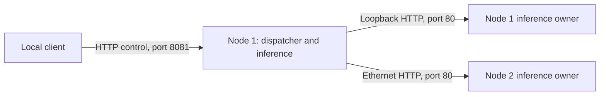

# Hardware and electrical status

## Measured configuration

Two Waveshare ESP32-P4-WIFI6-POE-ETH boards, with ESP32-P4-Core and ESP32-C6.
Both tested P4 chips report revision 1.3, 32 MiB flash and 32 MiB PSRAM.
Firmware uses a 360 MHz CPU configuration and 200 MHz PSRAM configuration.
ESP-IDF is 5.5.4. Builds for chip revisions 1.x and 3.x were checked; **3.x was
not tested on physical hardware**. PCB revision and the precise switch model
were not independently established.

Each board had its own Ethernet connection without PoE and USB-C power from a
computer during the reported experiments. The C6 wireless coprocessor was not
used. The host submitted requests and collected evidence; inference and the
final autonomous dispatcher run on the P4s. Original factory flash backups were
retained privately. Secure boot and flash encryption were disabled in this lab
setup; no eFuse changes were made.

For the initial layer-split experiment, the master executed layers 0–2 and the
worker layers 3–5 sequentially for every position. For independent-request
throughput, both boards retained complete models and each executed a separate
generation. These configurations answer different research questions.

## Storage layout and recovery

Each of two application slots is 3 MiB. The model partition starts at 0x620000
and is 24 MiB. NVS stores persistent dispatcher configuration; jobs/results are
RAM-only. Model updates write a validated header last. Firmware updates use the
inactive slot and a subsequent LAN/PSRAM boot confirmation. Normal OTA and model
updates were tested. Deliberate OTA interruption/rollback was not fully tested.

A 16 GB SD card is planned for the master, but no reported inference depends
on SD. The loader currently copies the **entire** model into every board's PSRAM;
adding boards does not automatically increase the largest supported model.

## PoE/USB plans are not an electrical qualification

The proposed future wiring has one PoE Ethernet connection per board, plus short
permanent USB-A-to-USB-C links between neighbours. This chain was not used for
the reported inference experiments and has not been electrically qualified.
USB can continue powering a board after its PoE feed is removed; that behaviour
alone is not the failure criterion. Current limits, multi-board loading and
unwanted reverse current remain unmeasured. No suitable measurement instruments
were available. LEDs or a successful boot cannot establish safe current sharing.

The manufacturer schematic was reviewed. USB-C `Type_C_5V` connects through Q2
(AO3401), controlled using U13 (MMDT3906DW), to the 5 V rail. USB-A `VBUS_OUT`
uses U2 (DIO7003HEST5); R12 is marked NC/0R in parallel. Actual assembly must be
checked. The PoE module's internal protection is not established by this baseboard
schematic. The 3 A marking on the 3.3 V regulator is not a USB-A output rating.

Planned tests include each supply alone, both supplies, a powered/unpowered
neighbour, interrupted Ethernet power and realistic chain loading. These are
future measurements, not passed checks. Cutting VBUS is not assumed to preserve
USB detection. A PoE-off board may still be energised through another supply.

Manufacturer references:

- https://docs.waveshare.com/ESP32-P4-WIFI6-POE-ETH
- https://files.waveshare.com/wiki/ESP32-P4-WIFI6-POE-ETH/ESP32-P4-WIFI6-POE-ETH-Schematic.pdf
