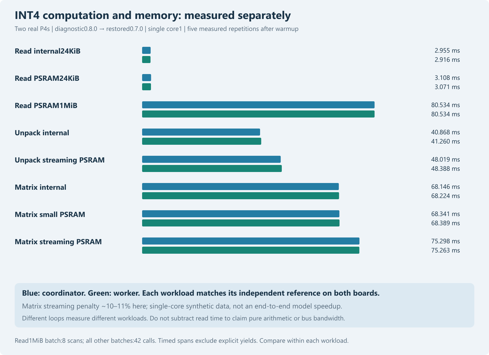

# INT4 arithmetic and memory access on both ESP32-P4s

Publication note: commands in the historical report retain their original research scope and integrity guards. For this redacted archive, use `python tools/verify_public_snapshot.py .` to reproduce recorded tables without model weights, credentials or devices. Original experiment/native-DLL commands require the separately supplied pinned assets and original environment; they are not claimed runnable from this archive alone.

30 October2026. Completed local diagnostic study; both nodes restored to firmware0.7.0/TinyBrainBot.

## Methods and acceptance

Protocol committed in2e2f6aa before measurements; LAN trial helper committed ind089d48. Diagnostic firmware0.8.0 adds an authenticated, maintenance-guarded endpoint. Model weights are unchanged. Single CPU core1,24KiB internal/PSRAM buffers,1MiB PSRAM streaming footprint,64x768 tile4 INT4 matrix, internal FP32 input, scale1. The same256-byte repeating pattern and vector are used for each placement. Timing sums bounded chunks and excludes explicit yields between chunks; interruptions inside chunks remain. Run0 is warmup, runs1–5 analyzed, mode order rotated and board order alternated.

Compiled diagnostic C results match independent Python arithmetic for memory sums, signed nibble unpacking and matrix output. All96 measured mode records match those checksums on actual hardware;80 records enter the primary analysis. No inference timings or host speed are substituted. The output checksum is124 per matrix call,5208 per42-call batch. The pattern is synthetic and the benchmark has specialized fixed4-bit code; it is not an exact production-kernel timing.

| Kernel | Coordinator median ms | Worker median ms |
|---|---:|---:|
| read_internal_small | 2.955 | 2.916 |
| read_psram_small | 3.108 | 3.071 |
| read_psram_large | 80.534 | 80.534 |
| unpack_internal | 40.868 | 41.260 |
| unpack_psram_stream | 48.019 | 48.388 |
| matrix_internal | 68.146 | 68.224 |
| matrix_psram_small | 68.341 | 68.389 |
| matrix_psram_stream | 75.298 | 75.263 |

## Interpretation

Small-buffer reads achieve about317–321MiB/s from PSRAM versus333–338MiB/s internally; a1MiB sequential PSRAM scan achieves about99MiB/s. These are logical checksum-loop throughputs, not physical bus bandwidth. The configured L2 is128KiB, so1MiB exceeds its capacity; no explicit cold-cache flush or hardware counter proves coldness. Internal/small PSRAM modes can benefit from cache.

The same matrix takes about68ms in the internal/small-buffer cases and75ms while rotating through PSRAM tiles: a roughly10–11% streaming penalty in this synthetic single-core test. Unpacking alone takes about41ms internally and48ms with streaming PSRAM. Packing/bit operations and FP32 accumulation are therefore material diagnostic work; raw memory-read time alone cannot explain the matrix interval. However these loops differ in load width, instruction mix and cache behavior: subtracting their times would not measure pure arithmetic.

Next useful controlled optimization: compare a production-compatible INT4 unpack/dot implementation against the existing scalar/tile4 path with identical output IDs/logits, separately across internal and streaming buffers, before a new end-to-end model trial. These data do not predict a dual-core inference speedup or establish isolated PSRAM stall time. No energy/thermal/physical clock measurements; configured CPU360MHz and PSRAM200MHz retained.

## Restoration and reproduction

Firmware0.8.0 and restored0.7.0 both passed a distributed four-token native-reference control. Both final0.7.0 nodes retain the genuine TinyBrainBot identities and roles, no pending OTA, configured cluster and zero queued/running jobs. Private signed/provisioned app images and keys remain excluded from Git. No partition/model/wiring change, new downloads or online upload.

All per-board raw JSON, checksums, original protocol, deployment hashes and final status are in [the data directory](../data/int4-memory-2026-10-30/). Run `python tools/analyze_int4_memory.py` for offline validation/summary/figure. `tools/run_int4_memory_trial.py` is a real-device action requiring the intended idle nodes and retained private rollback; it refuses an existing private run directory. The archived protocol is fixed; choose a separately versioned fresh run for replication.

