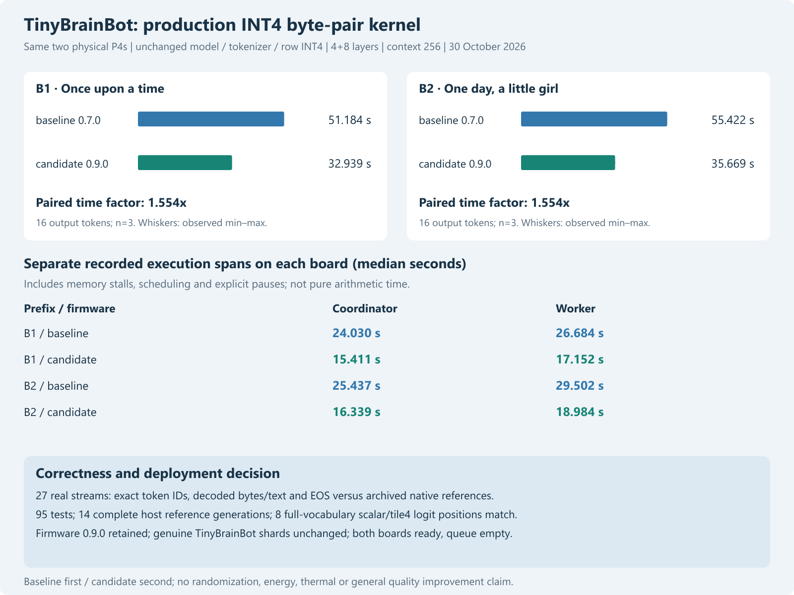

# TinyBrainBot production INT4 byte-pair optimization

Publication note: commands in the historical report retain their original research scope and integrity guards. For this redacted archive, use `python tools/verify_public_snapshot.py .` to reproduce recorded tables without model weights, credentials or devices. Original experiment/native-DLL commands require the separately supplied pinned assets and original environment; they are not claimed runnable from this archive alone.

30 October 2026. Local firmware-only experiment on the same two physical ESP32-P4 revision1.3 boards. No downloads, retraining or weight changes.

ESP-IDF5.5.4, revision1.x firmware target, performance optimization enabled, FP contraction disabled. Configured CPU360MHz, PSRAM200MHz, FreeRTOS1000Hz and both HP cores per board. Each board has32MiB PSRAM and32MiB flash; the24MiB model partition is unchanged. Clocks, temperature and energy were not independently measured.

## Result

Candidate admission: **retained firmware 0.9.0**. All 27 real streams match archived native token IDs, complete decoded output and EOS. This is a speed/correctness experiment, not an answer-quality improvement.

| Prefix | Baseline median s | Candidate median s | Paired baseline/candidate time factor |
|---|---:|---:|---:|
| B1 | 51.184253 | 32.938759 | 1.553760 |
| B2 | 55.422124 | 35.668861 | 1.553670 |

Final live readiness snapshots (reported allocator values, not an exhaustive memory stress test):

| Board | Firmware | Free PSRAM bytes | Free internal bytes | Model ready |
|---|---|---:|---:|---|
| coordinator | 0.9.0 | 4021276 | 427683 | True |
| worker | 0.9.0 | 3626016 | 428815 | True |

## Implementation and independent checks

The existing tile4 row loop now dispatches once per four-row block on matrix bit width. Its INT4 loop reads each byte once for two consecutive input columns. Explicit signed-nibble arithmetic avoids a runtime per-column bit-width branch and retains each row's original FP32 accumulation sequence. Scales, remaining scalar row tails, attention, tokenizer, INT8 representation and scheduling remain unchanged. No fast-math/FMA contraction.

A failing primitive compile test preceded implementation. Both numerical tests then passed: all 256 packed byte value (including signed -8), and random nonbinary FP32 inputs at widths 2/6/8/256/768/2048. Independent Python scalar arithmetic rounds every multiply/add to FP32 and compares bytes. A Windows mapped-DLL cleanup issue was corrected by unloading before deleting the temporary test directory.

All 95 existing/new tests pass using the separately built candidate DLL. Every load of the historical DLL path was redirected only within the test process; the historical DLL itself retains SHA256 4093a292d68c4bd393b447e75d9984f29a42e471f23c5bb4c69914797aec8efd. Fourteen genuine TinyBrainBot complete generations match previous references, and eight 32000-logit vectors are exactly equal between the candidate tile4 and candidate scalar-row paths. These bounded checks do not prove equivalence for all possible contexts.

## Trial design, limits and controls

The plan was committed before baseline collection. Both nodes started on 0.7.0, idle and ready with genuine unchanged model/artifact identities. W is a separate 4-token warmup; B1/B2 each use 16 output tokens with identical 4/6 input-token lengths and three repetitions. Prompt order alternates. Worker then coordinator receive 0.9.0 over authenticated private LAN. All 12 retained quality cases are regression checks with their original caps; no new blinded review or new quality denominator.

Each request uses both boards: coordinator layers0–3 plus embedding/output, worker layers4–11. This is not independent-request parallel throughput. Request timings are coordinator-clock elapsed durations. Master/worker execution profiles are spans including computation, cache/PSRAM stalls, scheduling and pauses. RPC total already includes worker execution; never add it to worker time.

Baseline precedes candidate and is not interleaved/randomized. Firmware0.9.0 also inherits the bounded diagnostic microbench endpoint from0.8.0; it is not invoked here. With only three descriptive repeats per prefix, min/max are not confidence intervals and no significance, general performance, quality, thermal or energy claim is made. No third-node simulation or claim.

The predeclared decision retains the candidate only when both prefix medians improve, all checks pass and neither board execution-span median regresses more than 5%. Final W control and both ready/idle states are recorded. Rollback 0.7.0 remains private and hash-verified. No model upload or partition change occurred.

## Evidence

[All 12 actual responses](../data/int4-pair-2026-10-30/comparison.html), [frozen plan](int4-pair-plan-2026-10-30.md), [protocol](../data/int4-pair-2026-10-30/protocol.json), [host checks](../data/int4-pair-2026-10-30/host-check.json), [summary](../data/int4-pair-2026-10-30/summary.json), [decision](../data/int4-pair-2026-10-30/decision.json), [final state](../data/int4-pair-2026-10-30/final.json). Every actual NDJSON stream and raw profile accompanies these files. Scientific self-review by the implementing assistant; no independent reviewer.

Offline reproduction of the recorded audit/figure: `python tools/analyze_int4_pair.py`. The explicitly staged LAN trial refuses to overwrite its baseline/candidate records. Never rerun deployment scripts merely to regenerate figures.
