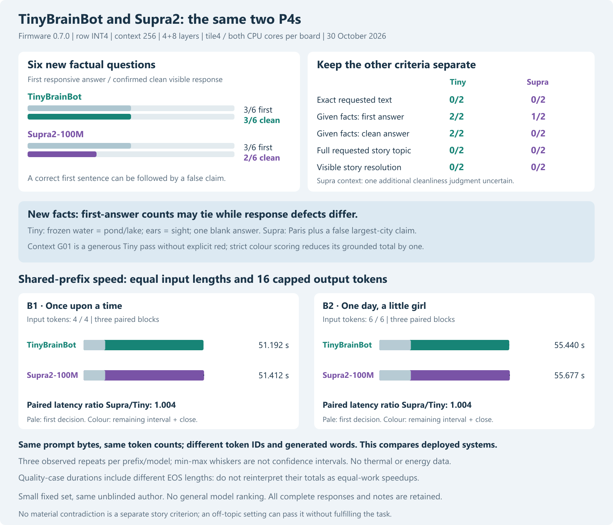
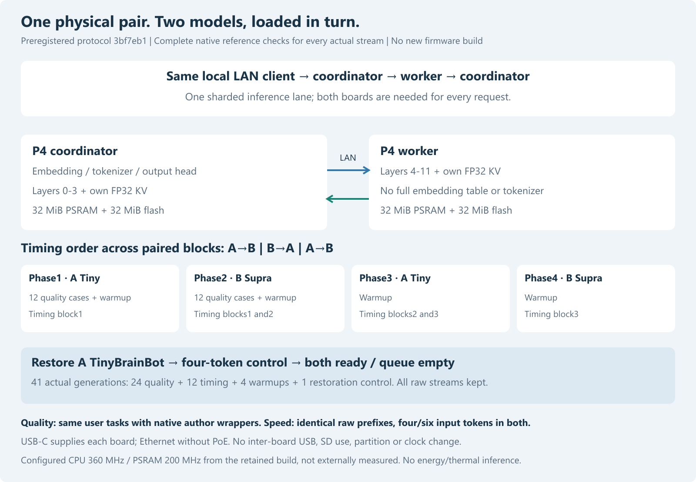
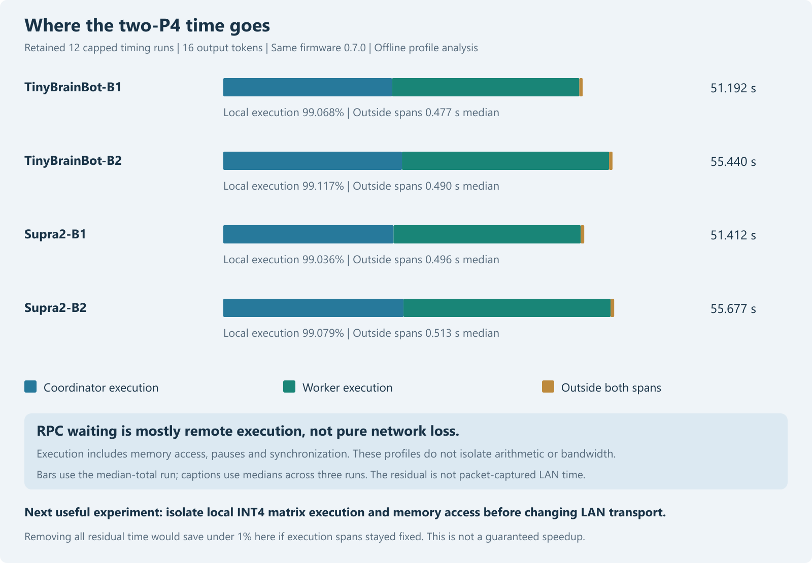

# TinyBrainBot and Supra2-100M under the same two-P4 conditions

Publication note: commands in the historical report retain their original research scope and integrity guards. For this redacted archive, use `python tools/verify_public_snapshot.py .` to reproduce recorded tables without model weights, credentials or devices. Original experiment/native-DLL commands require the separately supplied pinned assets and original environment; they are not claimed runnable from this archive alone.

30 October2026. Device study completed;41 complete streams and restoration audited.

## Question and design

Does the local TinyBrainBot candidate preserve its practical answer-quality
advantage, and how fast are the two deployed systems on the same pair of P4s?
The earlier [30-task local comparison](tinybrainbot-local-2026-10-29.md) and
[real tokenizer port](tinybrainbot-p4-2026-10-29.md) are prior evidence, not
extra observations pooled into this study. These twelve new tasks are another
small exploratory sample; familiar facts may overlap training.

The [protocol](../data/matched-p4-2026-10-30/protocol.json) was committed in
**3bf7eb1 before all new host/device generations**. It pins tasks, expected
facts, full wrapper bytes, input IDs, caps, rubrics, artifact/source/DLL hashes,
model order, warmups and restoration. There is no candidate selection or
prompt adjustment after inspecting the new answers.

| Condition | TinyBrainBot | Supra2 |
|---|---|---|
| Pinned checkpoint | tinybrainbot-100m-v3-instruct | Supra2-100M-Instruct |
| Source revision | a8567bd7674f53b3fe5f42c8abaab35229a0e00e | 2c90ade6ab47b910f48d0157a3e4c421d6311ed5 |
| Actual parameters | 100,092,672 | 100,684,032 |
| Family | Llama; Metaspace BPE | Qwen3; byte BPE; Q/K head normalization |
| Vocabulary | 32,000 | 32,768 |
| Device execution | Same two P4s, one shared inference lane | Same two P4s, one shared inference lane |
| Firmware / kernel | 0.7.0 / tile4, both CPU cores | 0.7.0 / tile4, both CPU cores |
| Quantization / context / split | Existing row INT4, FP32 scales/KV; 256; 4+8 layers | Same |

Both genuine cached role files are reused unchanged, checked against prior
deployment hashes. The coordinator holds embeddings, tokenizer, layers0–3 and
output head; the worker holds layers4–11. A full artifact exceeds a single
board's32MiB PSRAM. This is capacity-sharing on dependent layers, not concurrent
independent requests on two replicated models. Model architectures and training
also differ; they are not isolated experimental variables.

Hardware is unchanged: two known revision1.3 Waveshare P4-Core/C6 boards,
LAN without PoE and USB-C power, no inter-board USB or SD use. Retained build
configuration is CPU360MHz/PSRAM200MHz/FreeRTOS1kHz, not externally measured.
No new firmware, partition, wiring or clock change during this experiment.

## Quality and timing are different workloads

Quality uses six facts, two exact-output tasks, two supplied-context questions
and two short-story instructions. Each model receives the identical user text
in its own pinned author-native wrapper. This is the same requested task, not
identical input IDs or complete wrapper bytes. Greedy/EOS, cap24 except stories48.
Equal token caps are not equal word/character budgets across tokenizers.

First responsive factual claim and the whole visible response are judged
separately. A correct first answer can coexist with a later false assertion.
Cleanliness uncertainty is retained, not counted as a pass. Exact outputs trim
outer whitespace only. Story topic, absence of a material contradiction and a
visible resolution are separate; a capped response can have a resolution, and
EOS is not a resolution. The same assistant reviews unblinded, with per-case
notes; there is no independent evaluator or combined quality score.

The timing workload uses identical **raw prefix bytes**, not the chat wrappers:
`Once upon a time` and `One day, a little girl`. They happen to encode to four
and six input tokens respectively in **both** models. Cap16, three paired
AB/BA/AB blocks; reverse prefix order in block2. Model loads are consolidated
into four phases A/B/A/B, with one four-token warmup per phase. Quality cases
run once in the first phase for each model. There is no automatic retry.

All sampled timing outputs must reach16 without EOS to admit the paired
total-latency ratio for that prefix. Source-reference and actual-device checks satisfy that
condition. Different token IDs and words
remain: these are deployed-system continuation timings, not identical semantic
answers or isolated arithmetic benchmarks.

Total elapsed and first-decision time are the coordinator's monotonic device
clock, not host HTTP wall time. The field `ttft_ms` marks the first selected
token/stop decision; an emitted token can decode to empty text. It is not
necessarily time to the first visible character. The decode proxy is
`(output_tokens-1)*1000/(elapsed_ms-ttft_ms)` for non-EOS capped outputs, including
final stream/RPC cleanup. Output characters/s are also retained; token rates
from different vocabularies are not pooled into a global score.

The three repeats yield descriptive medians, observed ranges and paired ratios,
not confidence intervals or a reliable superiority test. AB/BA/AB reduces simple
order drift but does not measure temperature or eliminate every confound. Quality
latencies have variable EOS lengths and cannot be treated as equal-work speedups.

## Reference, correctness and analytic work

Thirty native host continuations (12 quality, two timing and one warmup per
model) are produced once after preregistration. Every real response, including
warmups and restoration, is retained completely and must match token IDs, UTF8
bytes and EOS. Correct transport preserves model errors; it does not establish
factual correctness. Host generation is a reference check, not a device timing.
It reuses the portable C core, so exact outputs are cross-platform controls,
not an independent author-Transformers execution or on-device full-logit proof.

[Analytical matrix work](../data/matched-p4-2026-10-30/architecture-work.json)
is100,073,472 versus100,663,296 MACs per decode position. Both have12 layers,
width768, FFN2048 and12/4 query/KV heads. The vocabulary-sized output head makes
the difference in this count. It excludes attention products varying with
position, all norms (including Supra Q/K norm), activations, RoPE, scheduling,
pauses, traffic and memory behavior. It is not observed CPU instructions,
memory bandwidth, energy or a latency prediction.

## Results

| Measure | TinyBrainBot | Supra2-100M |
|---|---:|---:|
| First factual answer /6 | 3 | 3 |
| Confirmed clean facts /6 | 3 | 2 |
| Exact instructions /2 | 0 | 0 |
| Grounded first /2 | 2 | 1 |
| Grounded clean /2 | 2 | 0 |
| Story topic /2 | 0 | 0 |
| Story resolution /2 | 0 | 0 |

| Prefix | Tiny median seconds | Supra median seconds | Paired Supra/Tiny latency ratio |
|---|---:|---:|---:|
| B1 | 51.192 | 51.412 | 1.0043 |
| B2 | 55.440 | 55.677 | 1.0043 |

All41 complete device streams match their frozen native references; both genuine TinyBrainBot roles were restored, control passed and queue/running counts are zero. See [all responses and notes](../data/matched-p4-2026-10-30/comparison.html), [audit](../data/matched-p4-2026-10-30/record-audit.json), [paired timings](../data/matched-p4-2026-10-30/timing-summary.json) and [final state](../data/matched-p4-2026-10-30/final.json).

The new six-fact first-answer counts tie; this does not replicate a general Tiny superiority claim from the earlier different task set. Tiny gives cleaner short answers on some cases but names frozen water a pond/lake, names sight for ears, and emits a blank season answer. Supra correctly names Paris then falsely calls it the largest city in the world. Both fail the exact instructions and requested story plots within the frozen caps. No-material-contradiction passes for off-topic story settings do not mean successful stories. G01 Tiny receives a generous box-location interpretation without explicit red; requiring the colour reduces its grounded first/clean totals by one. Supra G01 cleanliness remains uncertain at its unfinished location clause.

Timing is interpreted separately: identical prefixes encode to four/six input tokens in both models, with16 non-EOS outputs per recorded reference. Paired total ratios describe these deployed systems, not a global ranking. Three observed repeats are insufficient for a reliable superiority test; inspect min/max and compute/RPC profiles. Quality-case time differences additionally include very different EOS lengths, including an empty decoded token, and are not equal-work speedups. Neither model is established as a reliable assistant.

Continuation amendment b7d28d3: the first Supra request was rejected HTTP409 before generation because the dispatcher configuration was bound to the Tiny model identity. A successful extra Tiny recovery control was retained separately in failed-attempt-restoration-control.ndjson. The original protocol and successful phase1 records were preserved; remaining phases resumed only after a committed amendment to reconfigure the cluster after every model switch. There were41 planned successful study streams plus one unplanned recovery stream; no generated Supra answer was retried. See continuation.json and error.json.

## Interpretation boundaries and reproduction

This test compares fixed deployed systems and a tiny task set. It cannot
establish a general model ranking, unseen-task accuracy, training causality,
energy efficiency or third-node scaling. Known prior task results are not
counted again. The user-visible quality question remains separate from raw
equal-length continuation speed.

The archived protocol refuses changed generating source/DLL/artifacts. For a
new experiment, choose fresh `--output` and `--private` directories for every
stage of `tools/compare_p4_models.py`: `prepare`, commit the new protocol, `host`,
then authorized `device` against the intended idle targets. Preparation records
the existing local asset paths; no dependencies or weights are fetched. Device
stage overwrites model storage and cold-reboots nodes, so keep compatible genuine
TinyBrainBot roles available. Firmware is unchanged throughout. Old completed
directories must never be silently overwritten or their source guards relaxed.

`tools/p4_compare_results.py` audits stored streams, protocol, joins, manual
counts, HTML and restoration offline. It does not load model weights or call a
device. `tools/plot_p4_compare.py` uses the existing Node/sharp renderer for
standalone SVG/PNG plots with source-hash sidecars. Retain raw outputs and original
freeze even if a separately documented amendment becomes necessary.

All work remains local: no new model download, dependency installation, external
inference or online publication. Private keys, full device identifiers, binary
deployment images and model weights stay outside Git.

## Follow-up: execution spans versus RPC waiting

Post-hoc offline decomposition of all12 retained timing runs finds median local
execution fractions99.036–99.117%. These spans include memory access, pauses
and synchronization, not just arithmetic. Median time outside both spans is
0.477–0.513 seconds per51–56-second request. RPC total already includes worker
execution; summing both would double-count remote work.

If those execution spans stayed unchanged, the unrealistic removal of ALL
remaining time yields only a1.0089–1.0097 conditional factor. This is an
accounting bound, not an achievable LAN speedup or a packet-measured network
fraction. The next useful speed experiment should isolate local INT4 matrix
execution and memory behavior, with output-head timing recorded separately.
The existing profiles cannot distinguish PSRAM stalls from arithmetic costs;
no bandwidth, energy or thermal measurement is inferred. No new device work
was done for this follow-up; original records and protocol remain unchanged.

[Derived per-run data and formulas](../data/matched-p4-2026-10-30/bottleneck-analysis.json).
Reproduce offline with `python tools/analyze_p4_bottleneck.py`.
