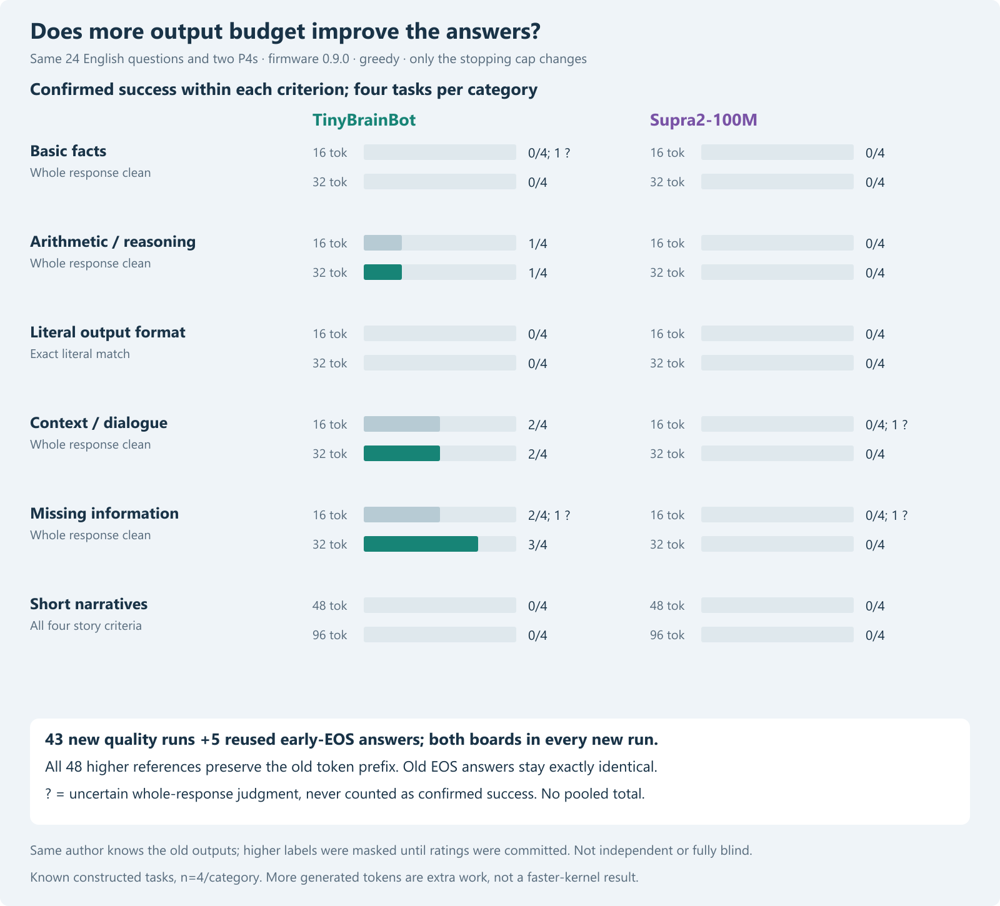
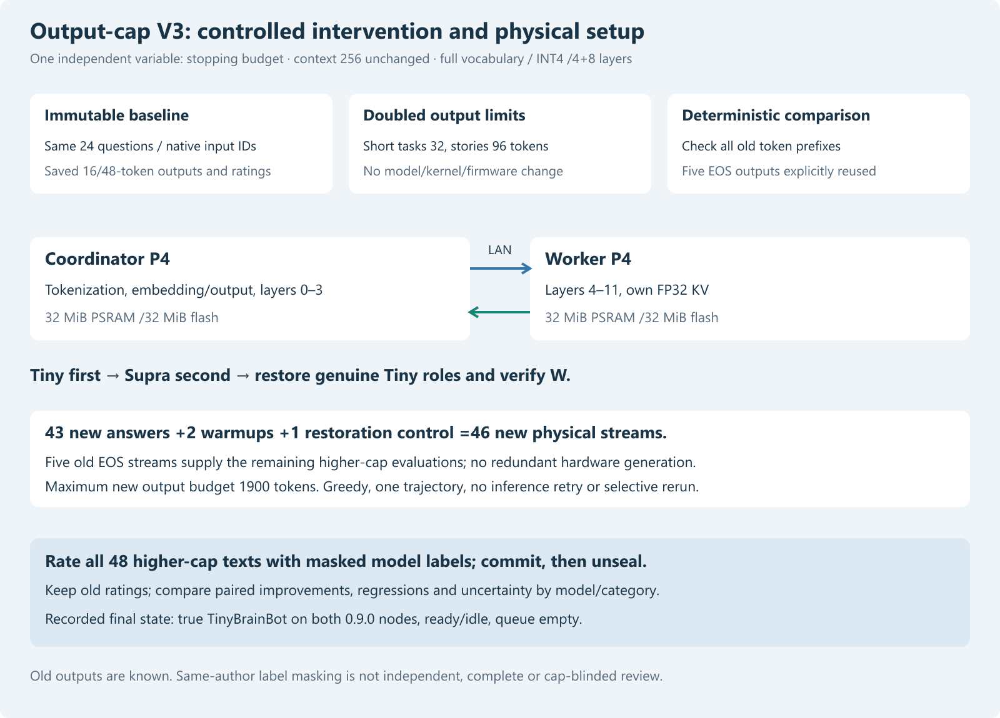

# Does doubling the output budget improve TinyBrainBot or Supra2?

Publication note: commands in the historical report retain their original research scope and integrity guards. For this redacted archive, use `python tools/verify_public_snapshot.py .` to reproduce recorded tables without model weights, credentials or devices. Original experiment/native-DLL commands require the separately supplied pinned assets and original environment; they are not claimed runnable from this archive alone.

## Result and paired category counts

The same 24 known English tasks were evaluated at doubled caps:32 versus16 output tokens for short tasks,96 versus48 for stories. Models, exact native inputs, greedy decoding, context 256, firmware 0.9.0, tile4 byte-pair INT4 and the same physical P4 pair remained fixed. All 48 old token prefixes are preserved.43 new quality streams, five explicitly reused early-EOS streams and three new controls form the higher-cap evidence.

| Model | Category | Old confirmed success | Higher confirmed success | Newly confirmed | Lost confirmed | Higher uncertain |
|---|---|---:|---:|---:|---:|---:|
| TinyBrainBot | Basic facts | 0/4 | 0/4 | 0 | 0 | 0 |
| TinyBrainBot | Arithmetic / reasoning | 1/4 | 1/4 | 0 | 0 | 0 |
| TinyBrainBot | Literal output format | 0/4 | 0/4 | 0 | 0 | 0 |
| TinyBrainBot | Context / dialogue | 2/4 | 2/4 | 0 | 0 | 0 |
| TinyBrainBot | Missing information | 2/4 | 3/4 | 1 | 0 | 0 |
| TinyBrainBot | Short narratives | 0/4 | 0/4 | 0 | 0 | 0 |
| Supra2-100M | Basic facts | 0/4 | 0/4 | 0 | 0 | 0 |
| Supra2-100M | Arithmetic / reasoning | 0/4 | 0/4 | 0 | 0 | 0 |
| Supra2-100M | Literal output format | 0/4 | 0/4 | 0 | 0 | 0 |
| Supra2-100M | Context / dialogue | 0/4 | 0/4 | 0 | 0 | 0 |
| Supra2-100M | Missing information | 0/4 | 0/4 | 0 | 0 | 0 |
| Supra2-100M | Short narratives | 0/4 | 0/4 | 0 | 0 | 0 |

Confirmed success means wholly clean for facts/reasoning/context/information, exact literal equality for format and all four frozen criteria for stories. Newly confirmed includes previously failed or uncertain answers; lost confirmed includes new failure or uncertainty. All nine paired success/failure/uncertain transitions remain in the JSON summary. No pooled model score.

### Missing-information controls

| Model | Information | Old core / clean | Higher core / clean | Higher uncertain |
|---|---|---:|---:|---:|
| TinyBrainBot | Not provided | 2/2 / 1/2 | 2/2 / 2/2 | 0 |
| TinyBrainBot | Answer supplied | 2/2 / 1/2 | 2/2 / 1/2 | 0 |
| Supra2-100M | Not provided | 0/2 / 0/2 | 0/2 / 0/2 | 0 |
| Supra2-100M | Answer supplied | 1/2 / 0/2 | 1/2 / 0/2 | 0 |

### Observed cost on the freshly rerun subset

| Model | Fresh cases | Historical seconds | Higher-cap seconds | Old / new output tokens |
|---|---:|---:|---:|---:|
| TinyBrainBot | 19 | 1461.236 | 2108.052 | 432 / 767 |
| Supra2-100M | 24 | 1911.792 | 2883.244 | 512 / 1024 |

These are server-reported generation elapsed sums for the same formerly capped cases, excluding reused EOS timings and controls. The baseline is historical, the higher-cap run fresh; output work differs and model order is fixed. This describes the observed cost of longer visible answers, not a randomized latency trial or an isolated speed change. Complete48-answer token totals and EOS/cap counts are retained in summary.json.

## Interpretation

The extra budget produces substantially more text without broadly rescuing answers in this constructed set. No previously confirmed failure becomes a confirmed success. No old confirmed success is lost. Tiny has one newly confirmed clean answer, U01, whose short form had already correctly acknowledged the unspecified address but ended inside another clause. The longer completed generic name/place clause supplies no invented street, town or house number, so the frozen missing-information criterion is now judged clean. This is resolution of one earlier uncertain judgment, not evidence of a new factual or reasoning capability. The same-author nature of that judgment remains a limit.

The other three old uncertain cleanliness judgments become failures: Tiny F01 extends the correct roots answer with an unqualified leaves-absorb-it claim in the soil-uptake context; Supra G03 repeats the obsolete coat location after the basket statement; Supra U04 invents a landscape and dense forests after correctly naming the supplied road. These continuations clarify previously unfinished text; they are not regressions from formerly confirmed clean answers. Core first-answer counts do not improve in any category.

Both models remain0/4 on exact literal format and0/4 on strict story completion. Already visible wrong literal prefixes cannot be repaired by appending text; these persistent failures are not independent new evidence that a larger model or a different prompt would fail. Topic/coherence/resolution totals also remain unchanged. Tiny gains the requested two-sentence format in S04 after completing its pear-sharing sentence, but still omits both friends feeling happy. It loses two-sentence format in S01 by continuing into further sentences. The aggregate Tiny two-sentence count stays1/4, masking those opposing case changes unless full paired results are inspected. Supra stays0/4 on that format criterion.

Five early-EOS Tiny answers remain exactly unchanged: increasing a maximum cannot force generation beyond EOS. Tiny now ends with EOS on13/24 cases (including those five), while11 still reach the new cap. All24 Supra outputs still reach the new cap. Neither EOS nor reaching a cap is a quality verdict; for example, Tiny still gives the wrong cup color before an EOS stop.

Across the48 evaluated answers, Tiny output grows489→824 tokens and Supra512→1024. For the freshly rerun19 Tiny cases, recorded engine elapsed sums grow1461.236→2108.052 seconds; for all 24 Supra cases,1911.792→2883.244 seconds. These are historical-versus-fresh observed costs with more output work, not a slowdown of the unchanged kernel. No measured energy or statistically representative quality-per-token claim follows.

For these retained artifacts and questions, simply raising the default cap is not supported as a broad quality fix. Keeping the short default and permitting a larger cap when a task needs it is a reasonable prospective operational choice, not a configuration change performed here. A future prompt/framing or source-versus-INT4 study would test a different cause and requires its own frozen protocol. Nothing here establishes how much another model, larger context or output beyond 96 tokens would help.

## Design, budget and evidence boundaries

The protocol and new model-label mapping commitment were frozen in9fb72c6 before any higher-cap reference. Every previous task string, expected criterion, model-native wrapper/input token ID and category order was copied unchanged. Maximum input length41 plus highest cap96 fits the unchanged context 256 without truncation. The maximum fresh hardware output budget is1900 tokens, including controls. No model download, re-quantization, firmware build/write, partition change or second quality sample occurred.

Existing local native code generated48 higher-cap references and two known W controls. Every old token sequence is an exact prefix. Five old Tiny answers already ended with EOS: R03, I01, G01, G02 and U02. Their higher-cap references are completely identical, so their previously verified actual device streams were explicitly reused. They are not new hardware trials. All43 formerly capped answers were newly generated on both P4s. Three new controls complete46 fresh streams;51 streams including the five reuses are audited against references. Old visible-byte prefixes are checked separately so a truncated multibyte token is not misclassified from Unicode substring comparison.

The device uses both HP cores per board in one distributed lane,4+8 layers, full vocabulary, FP32 KV/scales/norms and32 MiB PSRAM/flash per board. Configured CPU360MHz, PSRAM200MHz and FreeRTOS1000Hz are not independent power/clock/temperature measurements. Tiny then Supra is fixed model order to minimize writes. KV resets per request. Prompt processing is repeated for each new full answer; this is not a KV-cache continuation benchmark.

After recording, higher-cap outputs were rated with model names, token IDs, wrappers and timing hidden; caps/EOS remained visible. Ratings were committed in37bdb1c before the new mapping was unsealed. The same author knew old questions/answers/ratings and model styles. This is neither independent nor fully blind or cap-blinded review. Old ratings are unchanged; identical reused EOS answers must receive the same criterion judgments. All per-case notes and complete texts are exposed.

Longer text can complete a previously unfinished answer, but cannot erase a visible initial wrong answer or make extra prose satisfy an exact literal-copy request. Core and whole-response cleanliness remain separate. Uncertain semantic/unfinished judgments remain distinct from confirmed success and failure. Stories separately track topic, contradiction, requested resolution and exactly two sentences; EOS alone is not a resolution. No unseen output beyond the new limit is assumed.

Same deterministic prefixes isolate extra visible continuation under the retained engine; they do not prove source-FP32 fidelity or isolate training, quantization, model size or prompt effects. Questions are known and constructed, n=4/category, with possible pretraining overlap; one greedy trajectory does not support population ranking or statistical independence. Different tokenizers/native wrappers limit cross-model interpretation. More generated text changes work and wall time; no kernel-speed or energy-efficiency conclusion follows.

## Restoration and complete evidence

Genuine TinyBrainBot worker/coordinator artifacts were restored, model-bound peer configured, distributed W matched and both nodes reported0.9.0 ready/idle with queue0/running0. This is bounded recorded restoration evidence, not endurance or outage-injection qualification.

[All paired full texts and notes](../data/quality-cap-v3-2026-10-30/comparison.html), [protocol](../data/quality-cap-v3-2026-10-30/protocol.json), [prospective plan](quality-cap-v3-plan-2026-10-30.md), [old study](quality-v2-2026-10-30.md), [paired results](../data/quality-cap-v3-2026-10-30/paired-results.json), [summary](../data/quality-cap-v3-2026-10-30/summary.json), [record audit](../data/quality-cap-v3-2026-10-30/record-audit.json), [masked ratings](../data/quality-cap-v3-2026-10-30/masked-ratings.json), [unblinding](../data/quality-cap-v3-2026-10-30/unblinding.json) and [final state](../data/quality-cap-v3-2026-10-30/final.json).

Offline recorded-data reproduction: `python tools/quality_cap_v3_results.py analyze`. Uses retained data only; host/device stages are explicit guarded actions. No new publication/upload is authorized by this local experiment.
