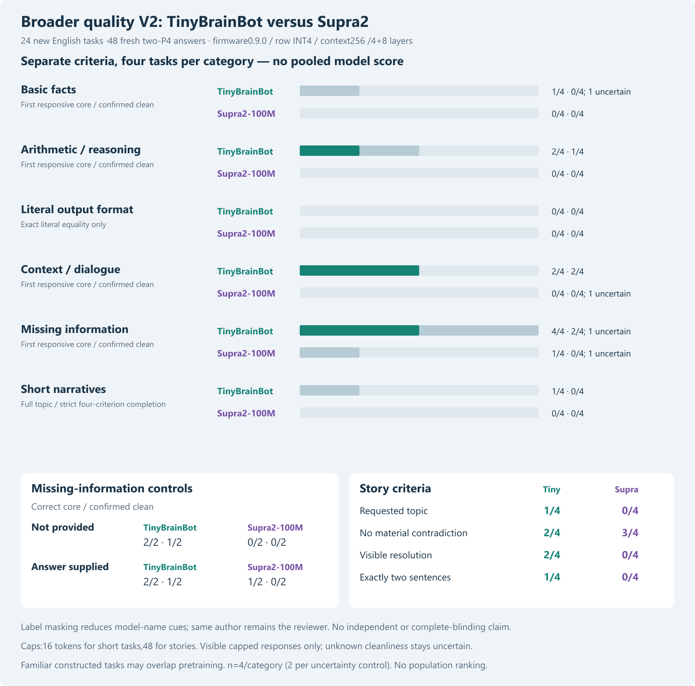
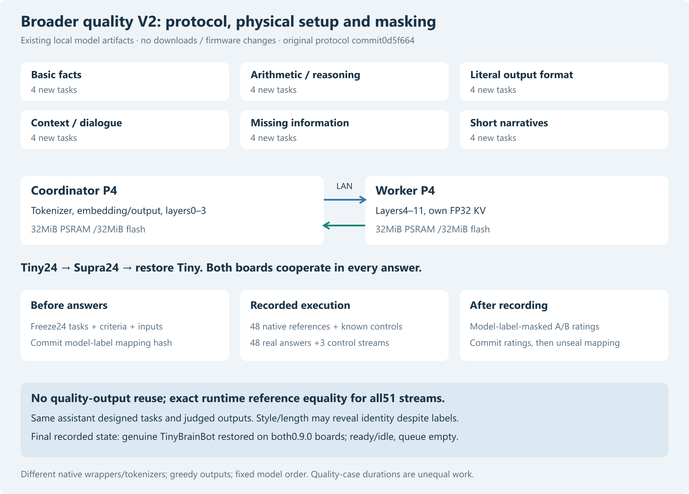

# Broader quality V2: new tasks on TinyBrainBot and Supra2

Publication note: commands in the historical report retain their original research scope and integrity guards. For this redacted archive, use `python tools/verify_public_snapshot.py .` to reproduce recorded tables without model weights, credentials or devices. Original experiment/native-DLL commands require the separately supplied pinned assets and original environment; they are not claimed runnable from this archive alone.

30 October2026. Twenty-four prospective English tasks,48 fresh actual two-P4 answers, no reused quality observations. Greedy row INT4 on firmware0.9.0, production byte-pair tile4, context256 and4+8 model shards. TinyBrainBot restored on both boards after the run.

## Study scope and primary results

| Category (4 tasks) | Tiny core / confirmed clean | Supra core / confirmed clean |
|---|---|---|
| Basic facts | 1/4 core; 0/4 clean; 1 uncertain | 0/4 core; 0/4 clean; 0 uncertain |
| Arithmetic / reasoning | 2/4 core; 1/4 clean; 0 uncertain | 0/4 core; 0/4 clean; 0 uncertain |
| Literal output format | 0/4 exact | 0/4 exact |
| Context / dialogue | 2/4 core; 2/4 clean; 0 uncertain | 0/4 core; 0/4 clean; 1 uncertain |
| Missing information | 4/4 core; 2/4 clean; 1 uncertain | 1/4 core; 0/4 clean; 1 uncertain |
| Short narratives | 1/4 topic; 0/4 strict completion | 0/4 topic; 0/4 strict completion |

Results are descriptive within this constructed sample. A correct first answer is not automatically a wholly correct response. Uncertain cleanliness remains separate; it is not silently treated as a success. The literal-format category tests exact copies, not a semantic JSON parser. Story topic, coherence, narrated resolution and exactly two sentences remain separate; strict completion requires all four. No pooled best-model score.

Different questions, review framing and short-task caps (16 here versus24 in the earlier matched set) prevent direct pooling with prior quality rates or interpreting changed rates as a model improvement. No weights or inference rule were improved in this study. Context/dialogue cases are supplied excerpts within one request, not an evaluation of persistent multi-turn memory.

## Interpretation of the new observations

Within these cases, TinyBrainBot has more correct first responsive answers in facts (1/4 versus0/4), reasoning (2/4 versus0/4), supplied context (2/4 versus0/4) and the combined missing-information/control category (4/4 versus1/4). Confirmed wholly clean responses are much rarer: Tiny records0/4,1/4,2/4 and2/4 respectively; Supra records0/4 in each. Four semantic/unfinished-response judgments remain uncertain across the two models and are not counted as confirmed successes. This supports retaining Tiny as the current experimental baseline, not certifying a generally reliable assistant.

Tiny correctly computes four plus three in R01, retrieves Ben's turtle in G02 and explicitly acknowledges the unknown card count in U02. The same model still invents a brown cup in G04 despite the supplied yellow record and adds an unsupported alternative to the supplied locker code in U03. Supra fails the subtraction with nine remaining and treats the shop name as an address. Full text and notes, including successful and failed cases, are retained together.

Both models fail all four exact-literal tasks and all four strict story completions. Supra has3/4 contradiction-free story outputs versus Tiny2/4, but this criterion alone rewards neither the requested topic nor a completed ending: unrelated or repetitive text can avoid contradiction while failing the task. Tiny narrates a fox returning the lantern in S03 but introduces mutually inconsistent sleep states and an extra sentence fragment. A hat-found claim in S01 does not repair the missing snail-loss/robin-help narrative.

All24 Supra answers and19/24 Tiny answers reach the output cap. The cap constrains what can be concluded about eventual completion; it does not erase already visible wrong arithmetic, wrong supplied facts or literal-format violations. No longer continuation was sampled. A future cap-sensitivity or prompt/template experiment needs a new frozen protocol, fresh outputs and separate reporting. Quality-case wall times reflect different token counts and tokenizers; the previously recorded fixed-prefix timing study remains the speed evidence.

Runtime-reference equality demonstrates that the P4 pair reproduced the retained quantized native engine for these inputs; it does not establish FP32/source-model fidelity or explain whether limited capacity, original training, quantization, prompting or short caps caused a quality failure. No causal allocation among those factors was tested here.

## Prospective inputs, review and limitations

Cases, expected criteria, native wrappers, input IDs, artifact/source hashes, output caps and balanced A/B mapping commitment were committed before any candidate answers in0d5f664. All24 exact user-task strings are absent from18 earlier committed protocols. This is novelty relative to our recorded strings, not evidence of pretraining-held-out tasks; familiar task templates and topics overlap earlier work. Neither questions nor caps were selected after viewing candidate answers.

Four tasks each cover facts, arithmetic/logical reasoning, exact format, provided context/dialogue, missing information and short stories. Missing-information behavior includes two genuinely unanswerable cases and two supplied-answer controls. All short-task caps are16 and story caps48. At most1024 quality output tokens were allowed across both models; EOS stops earlier. The visible capped response is the evaluation boundary; no unseen continuation is assumed.

After recording and restoring the cluster, A/B texts were shown without model name, timing, token IDs or native wrapper. EOS/cap status and frozen task criteria were visible. The same assistant rated all48 label-masked responses; these ratings were committed in5de1bb8 before copying the committed mapping into the unblinding receipt. The random nonce/mapping reproduce the original SHA256 commitment. No post-unblinding rating change is silently allowed.

The author also designed and executed the study and knew the model families. Style, length or self-identification can disclose the model. Therefore this is model-label masking, not independent assessment or complete blinding. Only four constructed cases/category (two per uncertainty subgroup), one greedy trajectory and one English framing pair are tested. No population ranking, confidence/significance guarantee, German-language proficiency or general-assistant qualification follows. A broader set is still not a representative standardized benchmark.

## Runtime, order and restoration

The same two physical revision1.3 P4s run each model in a single distributed inference lane. Both HP cores per board are configured; full vocabularies, FP32 KV/scales/norms,32MiB PSRAM/flash per board and existing24MiB model partitions remain. Configured CPU360MHz, PSRAM200MHz and FreeRTOS1000Hz are not independent clock/temperature/power measurements. No firmware build/update, partition change, model download or re-quantization occurred.

Existing accepted native DLL generated48 new full references and two known W controls. The known controls remain exactly equal to their earlier references. Archived DLL and genuine artifact hashes are preserved;95 existing local tests passed against the candidate DLL. Host reference correctness is distinct from answer quality. All51 new physical streams (48 tasks, two warmups and one restoration control) match model-specific token IDs, full decoded text and EOS, with both boards reported and coordinator owner/helper core masks checked.

Task order round-robins the six categories, identically for both models. Tiny runs first, Supra second; fixed model order minimizes writes and is not randomized. KV resets per request. Model-native wrappers/tokenizers differ. Quality durations have unequal actual output lengths and are not an equal-work model speed comparison. No inference retry or repeated quality sample was used. Device/runtime failures would abort further requests and trigger restoration.

Finally genuine Tiny worker/coordinator artifacts were reloaded, model-bound peer configured, distributed W verified and both nodes checked on0.9.0 ready/idle with queue0/running0. Restoration is recorded evidence, not an endurance, outage-injection or automatic factory-onboarding acceptance.

## Complete evidence and offline reproduction

[All full texts, frozen criteria and notes](../data/quality-v2-2026-10-30/comparison.html), [protocol](../data/quality-v2-2026-10-30/protocol.json), [case list](../data/quality-v2-2026-10-30/cases.json), [masked responses](../data/quality-v2-2026-10-30/masked-responses.json), [committed masked ratings](../data/quality-v2-2026-10-30/masked-ratings.json), [unblinding receipt](../data/quality-v2-2026-10-30/unblinding.json), [summary](../data/quality-v2-2026-10-30/summary.json), [raw audit](../data/quality-v2-2026-10-30/record-audit.json), [final state](../data/quality-v2-2026-10-30/final.json) and [prospective plan](quality-v2-plan-2026-10-30.md).

Recorded-data analysis: `python tools/quality_v2_results.py analyze`. This stage uses saved data, not weights, native inference or LAN. The explicit trial prepare/host/device stages require the pinned recording environment/assets and refuse overwrite. Historical protocol hashes and source guards must not be disabled to present saved output as a new experiment. All project data remain local/private LAN until a separately approved publication payload is prepared.
