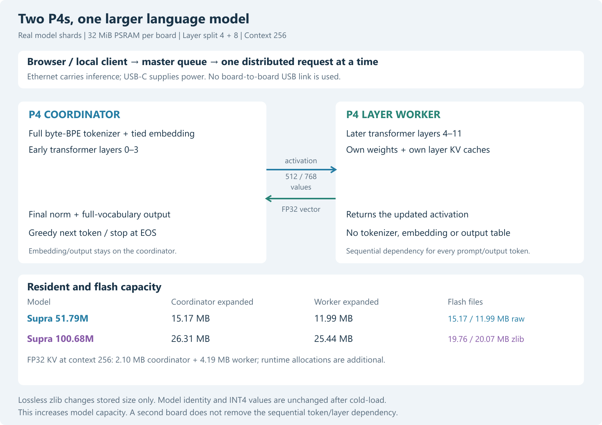
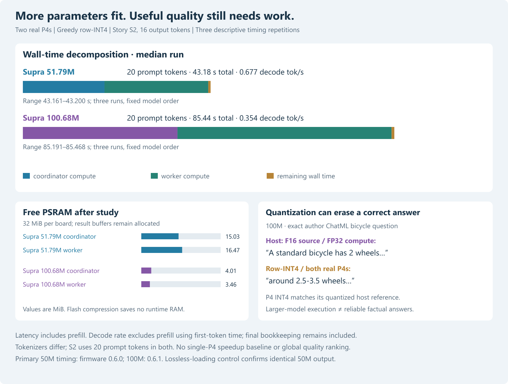

# Supra on two ESP32-P4s: real model shards and INT4 controls

Research date: 29 October 2026. Local experiment; new results are not published.
Both model ports, host controls and two-device studies are complete.
The cluster currently runs the 100M shards on firmware 0.6.1.

## Question and scope

Can these two 32 MiB-PSRAM P4 boards run larger, complete-vocabulary models by
holding different parts of one model? Does numerical correctness survive this
split, and what quality and latency remain after INT4 quantization?

This differs from the previous replicated TinyTalk dispatcher: each old board
had the entire model and could serve an independent request. Here the coordinator
holds embedding/output, tokenizer and layers 0–3; the worker holds layers 4–11.
Build configuration: two HP CPU cores, default 360 MHz CPU clock, 200 MHz
PSRAM clock and a 1 kHz FreeRTOS tick, ESP-IDF v5.5.4, revision-1.x target.
Clocks, link rate, temperature and power were not externally measured.
One request needs both boards. The worker never tokenizes or produces text.
The dispatcher therefore has one distributed execution lane and queues further
requests. Both role-specific artifacts share a logical model identity and have
different artifact hashes. A mismatched identity or layer range is rejected.

## Pinned sources and representation

| Model | Source revision | Parameters | Architecture | Source precision |
|---|---|---:|---|---|
| [Supra1.5-50M-Instruct-exp](https://huggingface.co/SupraLabs/Supra1.5-50M-Instruct-exp/tree/f0566e6be9f1cd3530fe004ce4e56a5c4148bf73) | `f0566e6be9f1cd3530fe004ce4e56a5c4148bf73` | 51,786,240 | Llama, GQA 8/4, 512 wide | Original BF16 safetensors, 103,584,616 bytes |
| [Supra2-100M-Instruct](https://huggingface.co/SupraLabs/Supra2-100M-Instruct/tree/2c90ade6ab47b910f48d0157a3e4c421d6311ed5) | `2c90ade6ab47b910f48d0157a3e4c421d6311ed5` | 100,684,032 | Qwen3, GQA 12/4, 768 wide, Q/K head RMSNorm | Author F16 GGUF, 202,580,384 bytes |

Files are data, never imported upstream Python. Each offline import explicitly
selects the pinned BF16/author-F16 file and verifies weight and companion hashes;
another checkpoint file cannot silently replace it. Both downloads are checked
against the pinned LFS SHA-256. Using the author's F16 export saves about
200 MB versus downloading the 100M F32 checkpoint. It introduces an explicit
F16 source-precision limitation: the controls do not establish full F32 parity.
Four selected Q/K row slices, two projections in the first and last layers,
also match the HF F32 source after F16 rounding; the check downloads 66,048 bytes.
This detects the relevant row-layout error, not equivalence of all F32 weights.

Every matrix, including the tied embedding/output table, uses symmetric row
INT4: maximum absolute row value divided by 7, ties-to-even rounding, range
−7…7 and float32 row scales. Two signed two's-complement nibbles occupy each
byte, low nibble first. Norms remain float32. This is a new experimental
quantizer, **not GGUF Q4_K_M**. Full vocabularies (32,000 / 32,768), all 12
layers and context 256 are retained. Quantization quality must be measured.

Source RoPE uses rotate-half order. Q/K projection rows and Qwen3 head norm
weights are reordered to the C kernel's adjacent complex-pair representation.
RMS epsilon and RoPE theta come from each source config. KV caches contain
only the locally stored layers and remain float32.

## Storage and recovery

| Artifact | 50M expanded bytes | 100M expanded bytes | 100M compressed flash bytes |
|---|---:|---:|---:|
| Coordinator | 15,169,700 | 26,312,708 | 19,757,583 |
| Worker | 11,985,152 | 25,440,512 | 20,074,249 |
| Complete host artifact | 27,154,596 | 51,752,964 | Not used on a P4 |

The existing model partition is 25,165,824 bytes. Both 100M raw shards exceed
it. A lossless zlib envelope solves this flash limit: firmware 0.6.1 streams
from that same partition into the final PSRAM allocation using the P4 ROM
decompressor. The compressed stream, expanded artifact and inner model envelope
are checked with SHA-256; zlib also checks its Adler-32 and the model parser its
CRC-32. The expanded bytes, INT4 values and logical identity are unchanged.
No flash-tail use, partition-table rewrite or vocabulary pruning is required.

Bounds are checked before flash erase or allocation, and the upload header is
committed last. A bad or interrupted replacement can leave the model unavailable
after reboot; the authenticated LAN firmware/model recovery service remains
available. Model installation itself is not an A/B model update. Firmware still
uses the inactive OTA slot. Private 0.5.5/0.6.0 images and TinyTalk-2/50M artifacts
are retained locally. Restore a compatible model before downgrading firmware.

## Frozen protocol and independent checks

The exact shared task prefixes come from the previous four-model study. No
prompt is changed after observing its output. The 50M tokenizer supplies no chat
template or automatic BOS, so none is invented. Its 16 cases cap output at 32
tokens. The 100M study retains those prefixes with a stated 16-token cap and
adds seven separately labelled author-ChatML probes. The template is hashed.
EOS 2 and ChatML end token 6 stop 100M generation. Native-chat and raw-prefix
results must be interpreted separately. Neither is a held-out benchmark.

For 100M, eight hardware cases and two dispatcher cases were selected before
generating outputs. Timing uses story S2, cap 16, three repetitions, on both
models. Prompt bytes agree; tokenizer token counts can differ. Timings include
prefill and generation. Approximate decode rate is `(output_tokens−1) /
(completion−first_token)`; it excludes prefill but includes final bookkeeping.
Three repetitions provide descriptive medians/ranges, not confidence intervals.
Model order is fixed: 50M first, 100M second. Warm caches and ordering may matter.

| Host check | 50M | 100M |
|---|---:|---:|
| Tokenizer probes against pinned `tokenizers` backend | 953 | 960 |
| Individual vocabulary pieces checked | 32,000 | 32,768 |
| Full-logit positions against independent source-layout NumPy | 8 | 8 |
| Largest absolute logit error | 0.000104904 | 0.000308990 |
| Top token agrees at all eight positions | Yes | Yes |
| Complete vs genuinely sharded C logits bit-identical | Yes | Yes |
| Full C generations equal independent INT4 NumPy | 16/16 | 23/23 |

The P4 comparison checks tokens, decoded bytes and EOS, not full on-device
logit vectors. Small device logit differences with the same argmax are unmeasured.
The NumPy oracle uses source rotate-half layout and separate float32 matrix
operations; it does not call the C kernel or copy upstream model code. A
tokenizer differential test found an ordering error around whitespace preceding
digits. A regression fixture reproduced it; making Digits terminate its segment
before ByteLevel whitespace lookahead fixed it. Original generation protocol
bytes were retained during revalidation.

## 50M hardware observations

Firmware 0.6.0 was staged worker first, then master, with a TinyTalk-2 single-board
control on each. The real role-specific 50M artifacts then cold-loaded and the
master saved its worker. All 16 direct requests used the saved worker without
specifying it in the request. Tokens, decoded bytes and EOS agree with the host.
Two submitted dispatcher jobs also completed in sequence on the shared model.
Three timing repetitions agree. These are 21 validated two-device generations;
the subsequent lossless-storage control is recorded separately.

Story S2, 20 prompt tokens and 16 emitted tokens, takes a median **43.182 s**
(range 43.161–43.200 s), with approximately **0.677 generated tokens/s** after
first token. Initial post-load free PSRAM was 16,093,212 bytes on the master
and 17,270,816 on the worker. After the study and retained dispatcher result
buffers, the master reports 15,757,332 free bytes. These are runtime observations,
not just a static size estimate.

For the longer 32-output-token S2 run, wall time was 66.943 s: 31.168 s master
compute and 35.081 s reported worker compute. RPC total minus worker compute was
0.655 s, about 0.98% of wall time. That remainder includes protocol/HTTP handling
and timing boundaries, so it is not a pure network propagation measurement.
The master shows owner/core masks 2 and 1 with overlapping matrix work. The
worker's individual core timing is not returned by this RPC protocol.

Why no request-latency speedup is implied: the worker cannot run its later
layers until the master sends the activation, and the master cannot choose the
next token until the worker returns. Embedding/output computation stays on the
master. The measured benefit is increased resident model capacity; overlapping
multiple independent requests is a separate design and is not implemented here.
No single-P4 50M/context-256 timing baseline is claimed. Its full artifact plus
KV cache already needs 33,446,052 bytes before network/runtime allocations. Its mandatory logits, attention and work
buffers raise that to at least 33,601,700 bytes, exceeding physical 32 MiB.

## 100M hardware observations and paired interpretation

Both compressed 100M shards cold-loaded successfully on firmware 0.6.1.
Eight prespecified direct cases and two queued dispatcher jobs match the host
at token, decoded-byte and EOS level. The two dispatcher intervals do not
overlap, as required for a single shared model. Three additional timing runs
also pass the token checks. This is **13 validated two-device generations**.
All 100M outputs in the short protocol reach their 16-token cap; this does not
establish natural long-form stopping or answer completion. Primary and secondary
EOS classification are also covered by the portable tests.

S2 uses 20 prompt tokens in both models. With 16 emitted tokens, the 100M
median is **85.442 s**, range 85.191–85.468 s,
and approximate post-first-token decode rate is **0.354 tokens/s**.
That is 1.979 times the 50M wall time for this case. The models differ
in width, FFN size, head normalization and training, so this is not an isolated
parameter-scaling law. The quantized kernels use software nibble unpacking and
float32 accumulation; packing does not by itself accelerate the arithmetic.

After the study, the coordinator has 4,207,636 free PSRAM
bytes and the worker 3,626,016; retained dispatcher results and
runtime allocations are included. Stored files remain 19,757,583 / 20,074,249
bytes while the resident model artifacts expand to 26,312,708 / 25,440,512.
The master saves its worker across reboot and subsequent requests need no peer
field. Both boards report ready, no worker lease and no pending OTA validation.

Across both primary studies, 34 two-device generations pass, plus the separate
50M compressed-loading control (35 in total). The independent local suite passes
61 tests, including all five INT4 execution modes and the last local KV position.
Eight non-destructive live rejection checks pass: missing key, worker text role,
wrong RPC split, wrong logical identity, coordinator used as worker, removing the
required peer, empty compressed stream and oversized expansion. The latter two
fail at the header gate before flash erase. Boot IDs, model/artifact identities
and the configured idle cluster are unchanged after all checks. There is no
power-loss, brownout, thermal, endurance or long-duration load claim.

## Quality and quantization observations

The larger parameter count does not establish a better assistant. Retain the
raw outputs and source-precision controls when interpreting the successful port:

* 50M INT4 continues S1 with “his carrot with his friend.” and reaches EOS.
  Its bicycle answer instead discusses herbs, and its cat answer claims eight
  legs. The BF16-source/FP32-compute control also makes factual mistakes, but
  correctly gives yellow for a banana and four legs for a cat; both deteriorate
  under this INT4 representation. All 16 complete token sequences change.
* 100M in its author ChatML format answers the bicycle question with
  “around 2.5-3.5 wheels” in INT4. The F16-source/FP32-compute control begins
  “A standard bicycle has 2 wheels”. This is a clear negative quantization
  finding, despite the numerically correct implementation of the quantized
  model. Both versions correctly answer that the opposite of hot is cold.
* The 100M one-word-blue instruction fails in both precision variants. Its
  raw serial-number prompt invents a number. No reliable instruction-following,
  factual-answering or uncertainty-handling capability is established.

These are small, unblinded exploratory examples with short output caps. The
100M native-chat cap can truncate later content. Do not turn them into a global
model ranking. In particular, successful larger-model inference is distinct
from useful model quality, and this per-row INT4 baseline needs improvement.

## Exploratory host-only group-64 follow-up

After the row-INT4 bicycle regression was observed, one bounded follow-up froze
four existing ChatML probes (N2, N4, N6, N7) before generating new outputs.
Matrices were quantized in groups of 64 columns with float32 scales. The
source, greedy decoder, prompt bytes and 16-token cap were retained. This is
an adaptive exploratory check, separate from the original frozen study.

Matrix-weight RMSE decreases from 0.00784240 to 0.00574173, yet the bicycle
answer becomes “The standard bicycle has 12 wheels”. The one-word-blue
instruction still fails. Group-64 also follows the rabbit/carrot story topic
more directly in this short prefix, but four selected probes establish no
quality ranking. Raw outputs and the hypothetical storage arithmetic are kept
in [the follow-up data](../data/supra100-group64-2026-10-29/protocol.json).

No group-64 C kernel or device artifact is implemented or installed. The
hypothetical expanded artifacts are 29,216,772 / 28,365,056 bytes before
2,097,152 / 4,194,304 bytes of KV storage and all network/runtime allocations.
The worker would have a narrow memory margin. Host output and a static budget
are not evidence of a P4 deployment. This follow-up supports a narrower next
step: evaluate quantization choices with actual answer controls, rather than
assuming that lower weight RMSE fixes a useful response.

## Evidence and reproduction

* [50M protocol](../data/supra50-2026-10-29/protocol.json),
  [host checks](../data/supra50-2026-10-29/host-report.json),
  [source controls](../data/supra50-2026-10-29/source-controls.json),
  [hardware runs](../data/supra50-2026-10-29/p4-runs.json),
  [timings](../data/supra50-2026-10-29/timing.json).
* [100M protocol](../data/supra100-2026-10-29/protocol.json),
  [host checks](../data/supra100-2026-10-29/host-report.json),
  [source controls](../data/supra100-2026-10-29/source-controls.json),
  [hardware runs](../data/supra100-2026-10-29/p4-runs.json),
  [timings](../data/supra100-2026-10-29/timing.json),
  [live rejection checks](../data/supra100-2026-10-29/lan-rejection-checks.json).
* [Build configuration and private-image hashes](../data/supra-build-2026-10-29.json).
  `tools/verify_supra_records.py` independently audits all saved case contracts,
  role identities and dispatcher intervals; `--lan` repeats the rejection checks.
* Run `tools/test.ps1` for native regression checks and `tools/build.ps1 -Revision
  rev1` for this hardware's firmware. The private LAN key is read locally.
* `tools/pack_supra.py`, `tools/check_supra_native.py` and
  `tools/supra_source_controls.py` export and validate pinned local assets.
  `tools/supra_p4_trial.py` and `tools/supra_storage_trial.py` perform explicit
  staged LAN actions; they are not background monitors or provisioning agents.

Downloads, model weights, private images, original device status and keys stay
under ignored `.local/`. English methods and non-secret measurement evidence
are tracked locally. New online publication requires a separate scoped approval.
