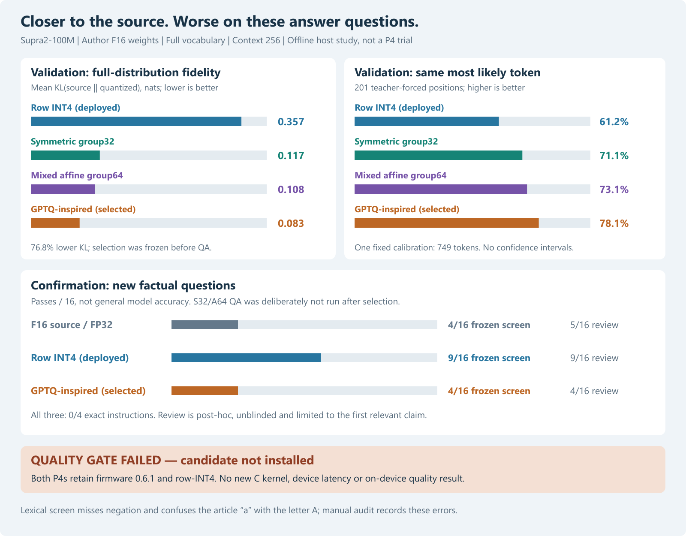
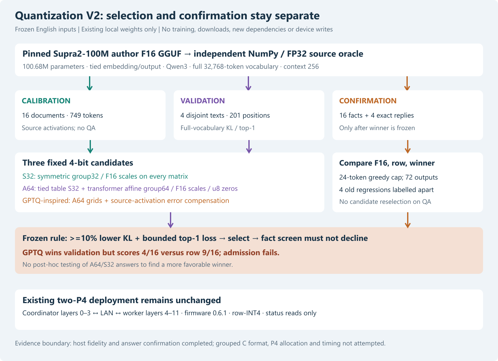

# Supra2-100M quantization V2: better source fidelity, failed answer confirmation

29 October 2026. **Completed offline experiment; candidate rejected.**
The selected GPTQ-inspired 4-bit representation reduces mean validation KL
by **76.84%** and increases source top-1 agreement from **61.19% to 78.11%**.
It nevertheless drops from **9/16 to 4/16** on the fixed factual answer screen.
Post-hoc first-claim review also finds 9 versus 4. The existing row-INT4 model
and firmware **0.6.1 remain on both P4s**. No grouped C kernel, new firmware,
model upload or new P4 inference/timing trial was performed.



[All 72 answers, token IDs, exact prompts and review notes](../data/supra-quantization-v2-2026-10-29/comparison.html)
are available as a self-contained local HTML page. Original JSON outputs and
the frozen protocol remain alongside it. This study is local, not a new
publication to the public research repository.

## Question and source

Can a more faithful post-training INT4 quantizer improve the deployed
Supra2-100M answers without changing its layers, full vocabulary or context?
This separates two questions: preservation of a source model's distribution,
and correctness/usefulness of its generated answers.

We reuse the pinned author checkpoint
[SupraLabs/Supra2-100M-Instruct, revision 2c90ade6ab47b910f48d0157a3e4c421d6311ed5](https://huggingface.co/SupraLabs/Supra2-100M-Instruct/tree/2c90ade6ab47b910f48d0157a3e4c421d6311ed5).
The source is `Supra2-100M-SFT-F16.gguf`, 202,580,384 bytes, SHA256
`f88228c3dcc13b5ee2333cbb6fc2416de908e5b8adabd39bf9ee4378f28451eb`.
It has 100,684,032 parameters, 12 Qwen3 layers, width 768, FFN 2048,
12 query heads / four KV heads and a tied 32,768-token input/output table.
Weights originate in F16; all reference computation uses FP32. **This is
not a test of equivalence to the original F32 training checkpoint.**
The previous [source/layout and real-device study](supra-model-parallel-2026-10-29.md)
provides provenance and the deployed row-INT4 baseline. No weights, tools or
dependencies were downloaded for V2.

## Frozen procedure

The [inputs](../data/supra-quantization-v2-2026-10-29/inputs.json) and
[protocol](../data/supra-quantization-v2-2026-10-29/protocol.json) were written before
collecting source activations or evaluating any complete-model candidate:

- **Calibration:** 16 fixed documents, 749 tokens in total, at most 64 per
  document. Twelve prose passages and four short ChatML exchanges. KV resets
  at each document. Input vectors are captured from the source F16/FP32 model;
  shared Q/K/V and gate/up inputs are stored once, yielding 48 activation arrays.
- **Validation:** four separate prose passages, 201 positions total, at most
  64 per passage. Each model consumes identical fixed tokens with a fresh KV
  cache. We compare all 32,768 logits after every position, including the final
  input position. This is teacher forcing, not free-running generation and
  not ground-truth next-token accuracy.
- **Confirmation:** 16 new elementary factual questions and four exact-reply
  instructions. These inputs are unused for calibration, scale selection or
  winner selection. They are **not claimed held out from pretraining**.
- **Known regressions:** N2 bicycle, N4 opposite of hot, N6 exact blue and
  N7 rabbit/carrot story are retained separately. They were already observed
  in the prior study and do not contribute to the new 16-question score.
- **Generation:** greedy argmax, full vocabulary, context 256, maximum 24
  generated tokens, stop at primary EOS 2 or ChatML end 6. Exact native author
  ChatML user/assistant framing, no implicit BOS and no prompt revisions.



The independent NumPy source-layout oracle preserves Q/K normalization,
GQA, rotary position encoding, tied output and all layers. Its optional
activation observer receives copies and is tested not to change the forward
calculation. V2 uses existing Python/NumPy only, with one OpenBLAS thread.
There is no Torch/CUDA dependency, gradient training or answer fine-tuning.

## Representations

All matrix integer payloads stay **4-bit**. Norm vectors and KV state stay
FP32. Metadata increases storage beyond four bits per weight.

| Name | Tied embedding/output | Transformer matrices | Scale/zero storage |
|---|---|---|---|
| Row, deployed baseline | Symmetric row | Symmetric row, nearest rounding | FP32 scale per row; no zero point |
| S32 | Symmetric group32 | Symmetric group32, nearest rounding | FP16 scale per group |
| A64 | Same S32 table | Affine group64, nearest rounding | FP16 scale and unsigned 8-bit zero per group |
| GPTQ-inspired | Same S32 table | Same A64 grids, second-order error compensation | Same metadata as A64 |

Symmetric integers are -7 through 7, stored as signed two's-complement nibbles;
affine integers are 0 through 15 with integer zero points 0 through 15. Groups
run across input columns within each output row. Candidate range fractions
are fixed at 1.00, .98, .96, .94, .92, .90, selected per group by weight MSE.
Scales are rounded to **actual stored FP16 precision before** integer selection
or compensation. An all-zero group has scale one and reconstructs zero exactly.
Integer rounding uses NumPy ties-to-even rounding.
The tied table is not optimized independently as an output projection.

The GPTQ-inspired variant follows the second-order compensation idea of
[Frantar et al., GPTQ](https://arxiv.org/abs/2210.17323), with the
[author implementation](https://github.com/IST-DASLab/gptq) as an algorithm
reference. Our independent NumPy implementation uses `H = X.T @ X / N`, damping
0.01 times the mean Hessian diagonal, natural column order, blocks of 128,
and static grids chosen from the original weights. It does not execute upstream
Python, use act-order or perform true-sequential reconstructed-layer calibration.
It is **not claimed numerically equivalent to the upstream GPTQ package**.
GPU benchmark claims from that work are not transferred to the P4.

The matrix payload plus group scale costs 4.5 bits/weight for S32; the affine
group64 payload/scale/zero costs 4.375 bits/weight. Descriptors, norms, tokenizer
and headers are additional. The `.local` NumPy caches are research objects,
not installable P4 artifacts.

## Selection and numerical results

For each teacher-forced position we compute
`KL(p_source || p_quantized)` from stable float64 log-softmax over the **whole
vocabulary**. Top-1 agreement compares each quantized argmax with source argmax.
Means are token weighted across all 201 positions.

An eligible candidate must reduce mean KL by at least 10% versus row and lose
no more than five percentage points of top-1 agreement. Among eligible
candidates choose minimum mean KL. All three pass; GPTQ wins. The
[selection record](../data/supra-quantization-v2-2026-10-29/selection.json), including
protocol and validation hashes, was saved **before any confirmation generation**.

| Representation | Mean KL, nats, lower is better | Source top-1 matches / 201 | Agreement | Weight RMSE |
|---|---:|---:|---:|---:|
| F16/FP32 source control | 0 | 201 | 100% | 0 |
| Row INT4 | 0.357129 | 123 | 61.1940% | 0.00784240 |
| S32 | 0.116924 | 143 | 71.1443% | 0.00478949 |
| A64 | 0.108480 | 147 | 73.1343% | 0.00463861 |
| GPTQ-inspired | **0.082701** | **157** | **78.1095%** | 0.00665232 |

GPTQ lowers KL by **76.8429%** and raises agreement by **16.9154 percentage
points** versus row. Its mean KL is lowest on each of the four individual
validation passages, not just in the pooled mean. Per-position and per-document
records are retained in `validation-*.json`. These correlated token positions
are not 201 independent experimental replications.

The GPTQ candidate has higher weight RMSE than either grouped nearest-rounding
variant but better distribution fidelity on these passages. That is consistent
with activation-weighted compensation targeting a different error criterion;
weight RMSE alone does not rank answer quality. The unchanged row RMSE comes
from the pinned-source [earlier weight reconstruction control](../data/supra100-group64-2026-10-29/weight-error.json).

## Answer confirmation and scoring audit

Only F16 source, row and the already selected GPTQ candidate generate answers:
24 cases each, **72 continuations**. S32 and A64 are not tested on these answers
after seeing the winner's failure; that would turn confirmation into selection.

The frozen screen looks for expected answer terms in the first sentence/line,
rejects listed conflicting terms and rejects other numbers for numeric cases.
Exact instructions compare the complete stripped response case-sensitively.
This is an operational screen, **not a semantic factuality benchmark**.

| Representation | Frozen fact screen / 16 | Post-hoc correct first relevant claim / 16 | Exact instructions / 4 |
|---|---:|---:|---:|
| F16 source / FP32 | 4 | 5 | 0 |
| Row INT4 | **9** | **9** | 0 |
| Selected GPTQ-inspired | 4 | 4 | 0 |

The admission rule requires the selected candidate's factual screen count to
be at least the row count. **4 < 9, so it fails.** We do not replace it with
an alternative selected on confirmation answers.

Unblinded [manual review](../data/supra-quantization-v2-2026-10-29/manual-review.json)
examines every visible answer and explicitly records defects in the automatic
screen without changing the frozen counts:

- F09: F16/GPTQ correctly call the Sun a star and negate planet. A forbidden
  phrase matcher does not understand the negation and falsely rejects them.
- F12: F16/GPTQ give incorrect generic descriptions of the alphabet, but the
  regex mistakes the indefinite article `a` for the requested first letter A.
- F06: F16 initially says three sides, then wrongly implies all triangles
  have equal sides. Its later word two triggers numeric rejection. A correct
  initial count is not a wholly correct explanation.
- Row also adds false material after some correct first answers: it describes
  the Sun as blue and Paris as the world's largest city. The first-claim review
  must not be read as complete-response correctness.
- GPTQ returns `Silver` for exact lowercase `silver`, then stops. This is close
  in content but still fails the predeclared exact case-sensitive instruction.

After these corrections, manual **first-claim** counts remain row 9 versus
GPTQ 4; that negative decision does not depend on the two regex defects. The
manual review is post-hoc, performed by the author without blinding or a second
independent rater. It does not replace the primary endpoint or support a
population-level quality claim.

The familiar bicycle regression improves only partially: GPTQ begins with
two wheels, then adds an inappropriate length in meters. We retain the full
24-token text rather than presenting a favorable cropped prefix. N7 restores
a rabbit subject but does not establish sharing a carrot within the cap.

## Interpretation and limits

1. **Distribution fidelity is not truth.** This checkpoint's F16 source is itself
   weak on these questions. Moving toward its distribution can reproduce its
   errors, whereas row quantization happens to give more correct first answers
   on this small set. This does not establish that row quantization generally
   improves a model or that the selected method generally harms factuality.
2. **Greedy trajectories can change sharply.** A small logit difference can flip
   an argmax and change subsequent context. Correcting the bicycle prefix does
   not guarantee a coherent continuation or improvements on other facts.
3. **Validation and intended use differ.** Prose-only validation measures source
   imitation on prose, while confirmation asks ChatML questions. Small mixed
   calibration and non-sequential source activations may also limit transfer.
   These are plausible explanations, not isolated causal findings: no ablation
   separates them here.
4. **No statistical or hardware extrapolation.** One fixed calibration, four
   passages, 16 facts, four exact instructions, one deterministic decoding path,
   and 24-token caps do not establish general language competence. Longer output,
   multiple seeds/datasets and independent ratings remain untested. No new P4
   speed, energy, memory-allocation or full-logit result exists for V2.

## Device boundary and hypothetical budget

The prior real deployment remains coordinator layers 0–3, worker layers 4–11,
full tokenizer/tied table on the coordinator, context 256, firmware 0.6.1.
Both boards were read over authenticated local LAN and were ready and idle.
No device POST, firmware/model write, queue change or restart was required.
The final sanitized [deployment check](../data/supra-quantization-v2-2026-10-29/deployment-unchanged.json)
records whether firmware, model/artifact identities and boots remained the same.

[Budget arithmetic](../data/supra-quantization-v2-2026-10-29/summary.json) uses a
**proposed**, unimplemented grouped matrix descriptor and unchanged 4+8 split:

| Candidate | Proposed expanded coordinator bytes | Proposed expanded worker bytes |
|---|---:|---:|
| S32 | 29,217,236 | 28,365,952 |
| A64 / GPTQ-inspired | 28,824,020 | 27,579,520 |

For A64/GPTQ, subtracting that growth from prior measured post-study free PSRAM
leaves approximately 1,696,324 coordinator and 1,487,008 worker bytes, before
any new kernel/runtime overhead or fragmentation. These are estimates, not
allocation proof. No compressed artifact was produced and the 24 MiB flash
gate was not evaluated: the earlier quality gate had already failed. We did
not implement an unnecessary device format or put a rejected candidate on the
working cluster. Context, partition table and SD usage stay unchanged.

## Reproduction and evidence checks

Use the existing local Python environment and pinned local source files; the
full sources/caches and private LAN records stay under ignored `.local/`.
The tracked research folder contains approximately 0.3 MB of text evidence
before figures, not weight blobs. Frozen outputs are not silently overwritten.
To reproduce from scratch, use a separate empty evidence/cache destination
after explicitly adapting `OUT`/`CACHE`; retain this original evidence unchanged.

```powershell
# Stages used in the original run, in this order; do not overwrite this run.
python tools/supra_quantization_study.py freeze
python tools/supra_quantization_study.py calibrate
python tools/supra_quantization_study.py candidates
python tools/supra_quantization_study.py validate
python tools/supra_quantization_study.py quality

# Offline audit and derived views of the retained run:
python tools/summarize_quantization_v2.py
python tools/plot_supra_quantization.py
python tools/verify_quantization_v2.py
./tools/test.ps1
```

The [audit](../data/supra-quantization-v2-2026-10-29/record-audit.json) verifies input,
source, code, selection and answer hashes, all **255** candidate cache files,
full answer token-to-byte reconstruction, all 72 records, HTML coverage and
eight old F16/row 16-token prefixes. The latter match prior references; they
are regression-prefix checks, not eight new device or full native executions.
The portable native build and **70 tests pass**: 61 pre-V2 tests, five earlier
quantizer/observer fixtures, and four new KL/selection/scoring/freeze tests.
They verify implementation contracts, not a Supra answer-quality gain.
The [verification receipt](../data/supra-quantization-v2-2026-10-29/verification.json)
records environment versions, build/test hashes and author self-review;
there was no independent reviewer.
Both PNG/SVG figures were generated from local JSON with source hashes and
visually inspected. The answer HTML contains no scripts or remote assets.

## Decision and next experiment

Keep the working row-INT4 deployment. Quantization V2 establishes improved
source imitation but **does not achieve the requested answer-quality gain**.
The conditional grouped C/firmware and device packages are not executed.

A sensible next experiment first checks a stronger candidate's original-
precision answers locally before investing in another P4 kernel. If pursuing
further Supra quantization, pre-register a new dialogue-aligned validation set,
repair the known scoring defects, and use genuinely new confirmation questions.
Do not reuse this confirmation set for hidden parameter tuning or select an
unmeasured alternative retrospectively.
