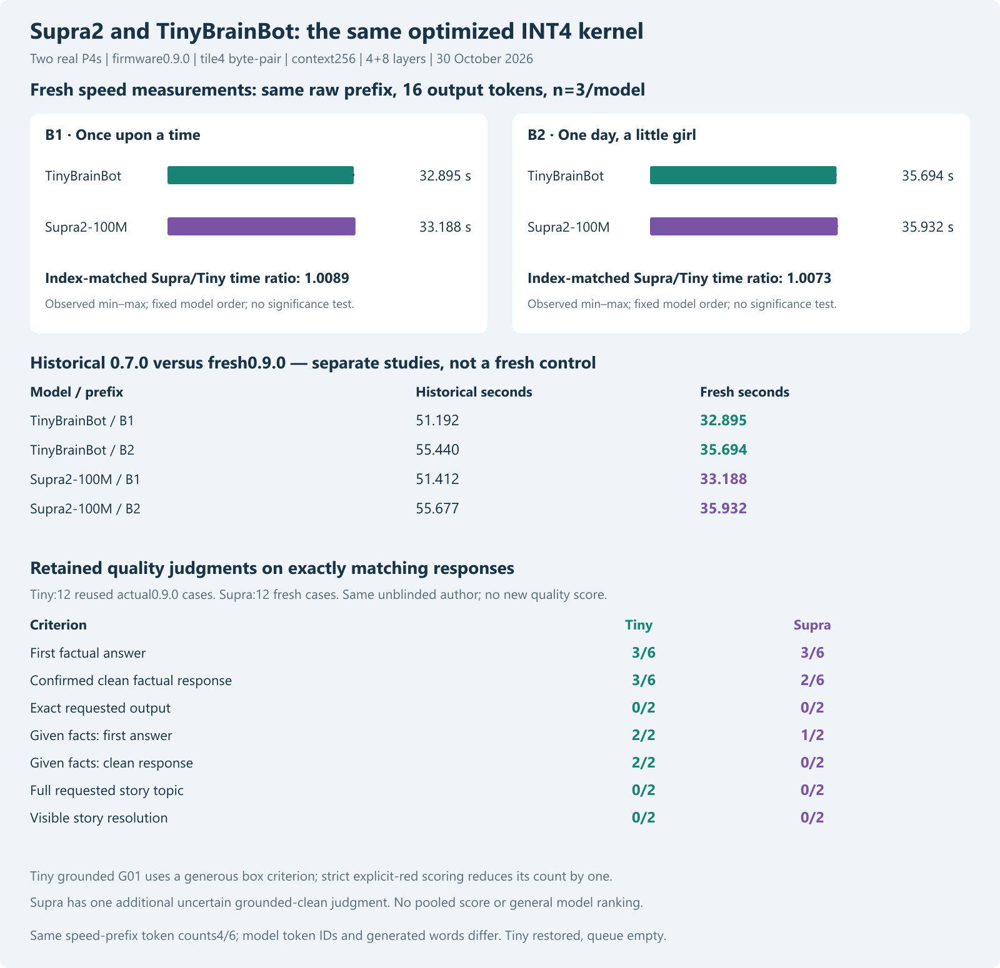
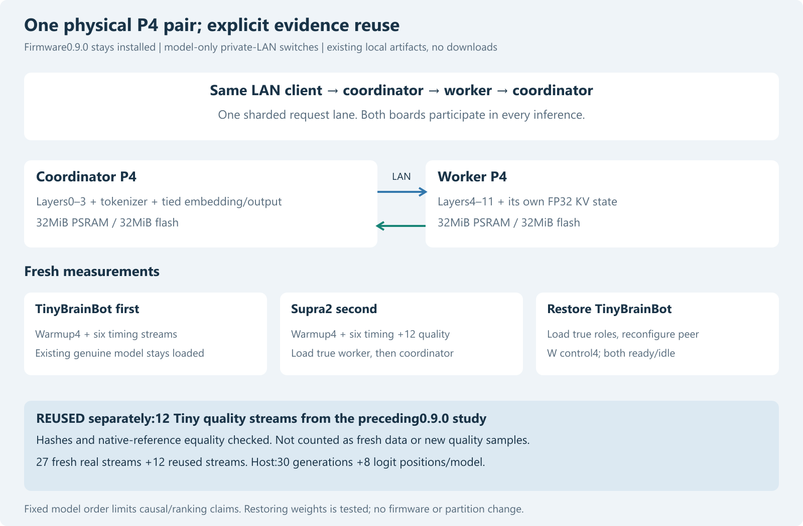

# Supra2 and TinyBrainBot on the optimized INT4 pair kernel

Publication note: commands in the historical report retain their original research scope and integrity guards. For this redacted archive, use `python tools/verify_public_snapshot.py .` to reproduce recorded tables without model weights, credentials or devices. Original experiment/native-DLL commands require the separately supplied pinned assets and original environment; they are not claimed runnable from this archive alone.

30 October 2026. Completed local experiment on the same two physical ESP32-P4 revision1.3 boards, firmware0.9.0. No downloads, new firmware build, re-quantization or partition change. TinyBrainBot restored on both boards after testing.

## Fresh speed comparison

| Prefix | Tiny median s | Tiny observed range s | Supra median s | Supra observed range s | Index-matched Supra/Tiny ratio |
|---|---:|---|---:|---|---:|
| B1 | 32.894535 | 32.732891–32.967331 | 33.187949 | 33.186908–33.198434 | 1.008920 |
| B2 | 35.693947 | 35.668299–35.725923 | 35.931806 | 35.921658–35.987359 | 1.007318 |

Each prefix has three actual timing repetitions per model,16 output tokens without EOS and exactly4/6 input tokens for B1/B2. Input bytes match; vocabularies/token IDs and generated words differ. These are deployed-system latency observations, not an isolated arithmetic benchmark or meaningful-answer throughput. The index-matched ratio uses repeat number, not randomized/interleaved model pairs. Model order is fixed Tiny then Supra to limit model writes. Min/max are observed ranges, not confidence intervals; small differences do not establish a reliable winner.

Median first-token latency and execution spans (spans include memory stalls, scheduling and pauses):

| Model / prefix | First token s | Coordinator execution s | Worker execution s |
|---|---:|---:|---:|
| TinyBrainBot / B1 | 5.834882 | 15.415948 | 17.163677 |
| TinyBrainBot / B2 | 8.721992 | 16.333876 | 18.978955 |
| Supra2-100M / B1 | 6.027774 | 15.562203 | 17.181636 |
| Supra2-100M / B2 | 8.746623 | 16.486108 | 19.013522 |

## Historical old-kernel context

| Model / prefix | Historical 0.7.0 s | Fresh0.9.0 s | Descriptive reduction % |
|---|---:|---:|---:|
| TinyBrainBot / B1 | 51.191699 | 32.894535 | 35.742 |
| TinyBrainBot / B2 | 55.439542 | 35.693947 | 35.616 |
| Supra2-100M / B1 | 51.412125 | 33.187949 | 35.447 |
| Supra2-100M / B2 | 55.677356 | 35.931806 | 35.464 |

These old measurements come from the separate matched0.7.0 experiment. They are not a new same-session old-kernel control for Supra. The prior Tiny byte-pair trial separately measured its own fresh before/after intervention. No source/configuration/temperature ablation isolates every contribution to differences between studies.

## Answer quality and evidence reuse

All12 fresh Supra quality streams and12 reused actual Tiny0.9.0 quality streams match the pinned native token IDs, complete decoded output and EOS. Therefore the existing manual judgments are carried forward, not silently rescored. The twelve Tiny cases were generated in the immediately preceding kernel trial and are individually hash-bound here; they are not new observations or included in this study's fresh timing samples. The same author reviewed them unblinded, with no independent rater. Known mistakes remain unchanged.

| Criterion | TinyBrainBot | Supra2 |
|---|---:|---:|
| First factual answer | 3/6 | 3/6 |
| Confirmed clean factual response | 3/6 | 2/6 |
| Exact output | 0/2 | 0/2 |
| Grounded first answer | 2/2 | 1/2 |
| Grounded clean response | 2/2 | 0/2 |
| Full story topic | 0/2 | 0/2 |
| Visible story resolution | 0/2 | 0/2 |

Tiny grounded G01 is a generous pass for box without explicit red. Strict explicit-colour scoring reduces Tiny grounded first/clean from2/2 to1/2; this is an inherited sensitivity, not a changed primary rule. Supra also has one uncertain grounded-clean judgment, additional to zero confirmed clean. No material contradiction is a separate story criterion and can pass an off-topic story; it must not be presented as successful story completion. No pooled quality score, new held-out benchmark, population ranking or new language competence follows.

The observed first-fact counts tie at 3/6. Tiny has 3/6 confirmed clean factual responses versus 2/6 for Supra2, but this small retained set is insufficient for a general best-model claim. Neither model satisfies either exact-output case or the full topic/resolution criteria for the two stories. The faster kernel preserves the answers; it does not improve their truth or instruction-following.

[All complete model responses, native wrappers and inherited notes](../data/supra-tiny-v09-2026-10-30/comparison.html).

## Implementation, memory and physical setup

Both complete-vocabulary row-INT4 models use the unchanged production byte-pair tile4 loop, FP32 scales/norms/KV, context256 and a4+8 layer split. Coordinator keeps tokenizer/embedding/output; worker keeps layers4–11. Both HP cores participate on each board. Same firmware0.9.0; configured CPU360MHz, PSRAM200MHz, FreeRTOS1000Hz;32MiB PSRAM/flash per board. Clocks, temperature and power were not independently measured. No SD or board-to-board USB test.

Both artifact families are the exact locally retained source-pinned files from the earlier matched study, authenticated by full hashes and model/artifact IDs. TinyBrainBot has 100092672 parameters (Llama), Supra2 has 100684032 (Qwen3 with Q/K head normalization). Norm/architecture differences and tokenizer output differ, so model comparison does not isolate training, parameter count or tokenizer effects.

| Model | Coordinator free PSRAM bytes after trial | Worker free PSRAM bytes after trial |
|---|---:|---:|
| TinyBrainBot | 4021276 | 3626016 |
| Supra2-100M | 4543516 | 3626016 |

These are reported free allocator bytes after the trial, not an exhaustive memory/fragmentation stress test. Coordinator and worker execution-span medians, including memory stalls/scheduling/pauses, are retained in summary.json. RPC total includes worker execution; do not add RPC and worker time.

## Checks, restoration and reproduction

Before physical writes,30 full candidate-native generations match archived references, including prompt-token IDs. Eight full-vocabulary logit vectors per model match the scalar-row path byte-for-byte. The historical DLL is preserved; the existing isolated candidate DLL is hash-bound to the accepted byte-pair source. All95 local tests pass. These bounded checks are not exhaustive for every possible input.

All27 new streams and12 reused streams are independently re-audited offline. Twelve fresh timing streams are kept apart from the quality cases and warmups. Model switching invalidates the saved model-bound peer configuration; the harness explicitly reconfigures the peer after each switch. In finally it restores genuine Tiny roles, reconfigures the peer, performs the four-token distributed native-reference control and verifies both0.9.0 nodes ready/idle with queue0/running0. No firmware replacement was necessary.

The plan/protocol and trial script were committed before new generations (0dc0603). Source hashes, artifacts, all retained responses, fresh and reused counts, role identities and the final state are checked by `python tools/analyze_supra_tiny_v09.py`, which is offline. The explicit `supra_tiny_v09_trial.py device` stage performs real private-LAN writes and refuses to overwrite a completed start record; do not run it to regenerate charts.

Evidence: [plan](supra-tiny-v09-plan-2026-10-30.md), [protocol](../data/supra-tiny-v09-2026-10-30/protocol.json), [host checks](../data/supra-tiny-v09-2026-10-30/host-check.json), [summary](../data/supra-tiny-v09-2026-10-30/summary.json), [reuse receipt](../data/supra-tiny-v09-2026-10-30/reused-tiny-quality.json), [final state](../data/supra-tiny-v09-2026-10-30/final.json), [verification](../data/supra-tiny-v09-2026-10-30/verification.json), [audit](../data/supra-tiny-v09-2026-10-30/audit.json). Author self-review, no independent reviewer. All project data stayed local/private LAN; no public transfer.
