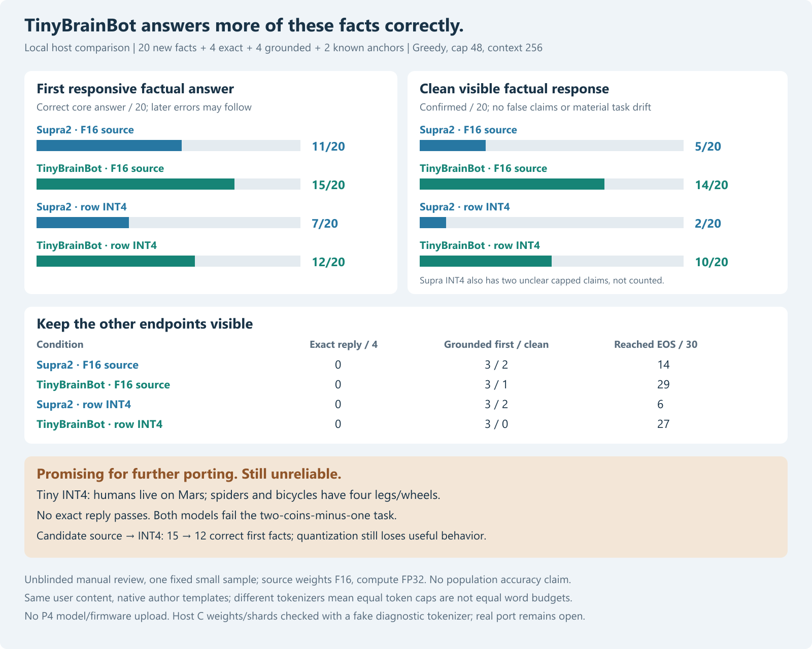
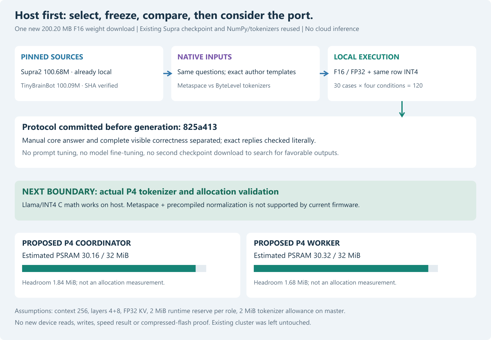

# TinyBrainBot versus Supra2: a promising local factual-generation candidate

29 October 2026. **Host comparison completed; no P4 adoption.**
TinyBrainBot-100M-v3-Instruct gives more correct first factual answers than
Supra2-100M on this fixed small sample, both from the author F16 sources
(15/20 versus 11/20) and after matched row-INT4 quantization (12/20 versus 7/20).
It also produces more confirmed-clean visible factual responses. Exact reply
instructions still fail, simple arithmetic fails, and elementary hallucinations
remain. This is a candidate for a tokenizer port and device validation, not an
already compatible replacement firmware or a general assistant-quality ranking.



[All 120 continuations, exact prompts, output token IDs and review notes](../data/tinybrainbot-local-2026-10-29/comparison.html)
are retained in a standalone local HTML page. Original JSON records are kept
beside it. The work, journal and Git commits remain local; nothing was uploaded
to the public research repository.

## Selection, provenance and download budget

The prior [Supra quantization V2 study](supra-quantization-v2-2026-10-29.md)
showed why better imitation of a weak source need not improve answers. This
experiment therefore compares a different **source checkpoint first**, with a
matched quantized condition to check whether useful behavior survives INT4.

We inspected public author metadata before choosing one weight download:

| Candidate | Pinned parameters | Decision |
|---|---:|---|
| TinyBrainBot-100M-v3-Instruct | 100,092,672 | Selected: compatible Llama math and plausible two-P4 budget; author reports a direct Supra comparison |
| NanoLM-70M-Instruct-v1 | 70,793,280 | Smaller Llama alternative; metadata only, not downloaded or ranked by our answers |
| SmolLM2-135M-Instruct | 134,515,008 | Outside current 4-bit all-resident memory budget |

Primary sources: the author repositories for
[TinyBrainBot](https://huggingface.co/nkthebass/tinybrainbot-100m-v3-instruct/tree/a8567bd7674f53b3fe5f42c8abaab35229a0e00e),
[NanoLM](https://huggingface.co/Mxode/NanoLM-70M-Instruct-v1/tree/62b7e506921618399c249374fea25820da5dd7e3),
and [SmolLM2](https://huggingface.co/HuggingFaceTB/SmolLM2-135M-Instruct/tree/12fd25f77366fa6b3b4b768ec3050bf629380bac).
The TinyBrainBot author's six-of-seven multiple-choice benchmark claim motivates
selection; **we did not reproduce that benchmark suite**. It is separate from
our answer-generation evidence. SmolLM2's ideal packed 4-bit matrices alone
occupy 67,239,936 bytes, already 131,072 bytes above two physical 32 MiB PSRAMs,
before scales, norms, tokenizer, KV or runtime. Lower bits or offloading would
be a different experiment. No stronger-model claim is made against untested
alternatives.

We also inspected the author cards of
[F2LLM-v2-80M](https://huggingface.co/codefuse-ai/F2LLM-v2-80M), which is an
embedding model rather than a generative assistant, and
[Mossez-100M-Instruct](https://huggingface.co/mossez-systems/Mossez-100M-Instruct),
whose author explicitly describes weak instruction/factual behavior. Neither
was downloaded or locally compared. The [selection record](../data/tinybrainbot-local-2026-10-29/selection.json)
preserves reasons, revisions and storage arithmetic.

The selected `nkthebass/tinybrainbot-100m-v3-instruct` revision is
`a8567bd7674f53b3fe5f42c8abaab35229a0e00e`. Its F16 `model.safetensors`
is **200,197,496 bytes**, SHA256
`24e663ce03dbbd0820601341e210b40524b4fa15f9940079351eaaf48236ac62`.
Only that one weight file and small data companions, including the approximately
3.46 MB tokenizer JSON, were downloaded. The alternative GGUF was not fetched.
Existing Supra source files, NumPy, tokenizers and native tools were reused.
No package installation, remote inference or model-repository Python execution
occurred. Weights and full author assets remain in ignored local storage.

TinyBrainBot has 12 Llama layers, width 768, FFN 2048, 12 query / four KV heads,
head dimension 64, RMS epsilon 1e-5, RoPE theta 10,000, tied input/output table,
32,000-token vocabulary and source context 1024. We use context **256**.
Its exact 110-tensor inventory, shapes, finite values and parameter count were
checked. Supra retains its pinned author F16 GGUF, 100,684,032 Qwen3 parameters,
full 32,768-token vocabulary and per-head Q/K norms. Both sources use FP32
computation after loading F16 weights; neither is an original-training-F32
equivalence test.

## Protocol fixed before answers

The [protocol](../data/tinybrainbot-local-2026-10-29/protocol.json),
[inputs](../data/tinybrainbot-local-2026-10-29/inputs.json), selection and evaluation
code were committed at **`825a413` before any answer generation**. The auditor
checks the retained protocol against the bytes in that commit.

- Twenty new elementary English factual questions T01–T20.
- Four exact lowercase reply instructions A01–A04.
- Four tasks G01–G04 using supplied information, including two coins minus one.
- Two separately labelled known Supra regression anchors K01/K02: bicycle wheels
  and exact blue. They do not enter the new-task endpoints.
- Four conditions: Supra F16/FP32, Supra row INT4, TinyBrainBot F16/FP32,
  TinyBrainBot row INT4. Thirty cases each, **120 continuations** total.
- Greedy decoding, no sampling or repetition penalty, full vocabulary, context
  256, maximum 48 generated tokens. No prompt tuning or answer fine-tuning.

These inputs are fresh relative to the recorded prior experiments, not claimed
held out from the models' pretraining. Native prompts differ intentionally:
each receives the same user text in its exact author tokenizer configuration.
This is a practical replacement comparison, **not a causal isolation of
architecture, training data, prompt format or tokenization**.

Supra uses its exact ChatML user/assistant template and stops at IDs 2 and 6.
TinyBrainBot's tokenizer configuration uses a leading space and space-separated
roles, although its model card shows a newline example:

```text
 <|user|> QUESTION <|end|> <|assistant|>
```

The first character is a space; there is no trailing space after the assistant
tag and no implicit BOS. We follow the actual pinned tokenizer-config template,
not a format chosen after seeing answers. All encoded prompt IDs are frozen.
TinyBrainBot stops explicitly at EOS **7** (`<|end|>`), even though this token is
not tagged `special` in its tokenizer JSON. Metaspace decoding uses the existing
local Rust tokenizer; it is not byte-piece concatenation. The full visible
output, including prompt/role/think leakage, is retained. Different tokenizers
mean an equal token cap does not impose equal word or byte budgets.

The row quantizer is identical in both conditions: symmetric scale
`max(abs(row))/7`, ties-to-even rounding, integers -7 through 7, FP32 scale per
row, tied embedding/output included, FP32 norms and KV. We do not run the
previous GPTQ candidate or tune a new quantizer on these answers.

## Endpoints and review

The primary endpoint is the manually reviewed first directly responsive factual
core answer on T01–T20. A second endpoint requires a clean **visible capped
response** without false statements, unsupported contextual inventions or
material task drift. Correct identity and false explanation are kept separate.
Unsolicited question/prompt echo is treated as task drift; declarative on-topic
repetition alone is tolerated. Two truncated claims whose cleanliness cannot
be determined are marked uncertain, excluded from confirmed-clean counts and
reported separately.

The author reviewed every complete visible answer without blinding or a second
independent rater. [Per-case judgments and reasons](../data/tinybrainbot-local-2026-10-29/manual-review.json)
make the interpretations inspectable. Automatic first-sentence term matching is
only a supporting diagnostic; it is not the factual judge. In particular:

- TinyBrainBot's wait for green paraphrase passes manual traffic-light review
  despite missing the expected stop keyword.
- Supra's immediate unconditional right turn followed by stop does not pass just
  because stop appears later.
- TinyBrainBot copies one coin in the supplied-context task, then answers two;
  the copied input must not count as a correct subtraction result.
- Smaller is accepted as Supra INT4's initial small-related antonym, although
  its later explanation is false. Tiny INT4 identifies honey, but falsely says
  it is gathered from flowers; the identity passes and the whole answer fails.

Exact replies compare the complete stripped response case-sensitively, with no
punctuation cleanup or post-hoc leniency. Grounded tasks require the answer
derived from supplied facts, not a matching term copied from the question.
The rubric was frozen; borderline judgments such as question echo and incomplete
claims were made during unblinded review and recorded, not predetermined labels.

## Results

| Condition | First factual core / 20 | Confirmed-clean facts / 20 | Exact replies / 4 | Grounded core / 4 | Clean grounded / 4 | EOS / 30 |
|---|---:|---:|---:|---:|---:|---:|
| Supra F16 source / FP32 | 11 | 5 | 0 | 3 | 2 | 14 |
| TinyBrainBot F16 source / FP32 | **15** | **14** | 0 | 3 | 1 | 29 |
| Supra row INT4 | 7 | 2, plus 2 uncertain | 0 | 3 | 2 | 6 |
| TinyBrainBot row INT4 | **12** | **10** | 0 | 3 | 0 | 27 |

The predeclared promising-candidate rule requires higher first-fact counts in
both precisions without reduced clean-fact counts. TinyBrainBot passes it.
On paired first-fact judgments it wins seven cases and loses three in F16;
after INT4 it wins eight and loses three. Ties remain visible in the raw data.
The advantage is not universal or dependent on only one favorable example.

For INT4, examples corrected relative to Supra include Jupiter as the largest
planet, four square sides, 60 seconds/minute, 24 hours/day and Berlin. However,
TinyBrainBot INT4 still says humans live on Mars, spiders have four legs,
tricycles have four wheels and ordinary bicycles have four wheels. The bicycle
anchor is not fixed by switching models.

Matched quantization still harms the candidate: first-fact counts fall **15 to
12**, and clean-fact counts **14 to 10**. It loses the normal red-light action,
heart answer and opposite of large. More EOS terminations mostly mean shorter,
finished outputs here; EOS alone does not prove correctness. Exact formatting
does not improve, and all four conditions fail two minus one.

Grounded first answers stay 3/4, but complete responses expose prompt echo and
self-contradiction: Tiny INT4's green bag becomes not green, and its clean
grounded count is 0/4 compared with Supra's 2/4. **The factual advantage is not
an across-the-board instruction/grounding advantage.**

The uncertain Supra INT4 clean cases are the cut-off sheep-breed ranking and
an unfinished yen numerical value. Accepting both would raise its clean-fact
count from two to four, still below ten. Alternative reasonable judgments on
the stop/wait paraphrase, smaller, or honey identity do not reverse the factual
comparison. They do limit how literally these small manual counts should be
treated. No confidence intervals, significance claims or population accuracy
ranking are inferred from twenty heterogeneous questions.

## Two-P4 feasibility and evidence boundary



The existing Llama C numerical path supports the candidate's math. A separate
**host-only diagnostic** exports its actual row-INT4 weights with a deliberately
synthetic ByteLevel vocabulary, feeds numerical token IDs directly and compares
all 32,000 logits at three positions in each of five kernels. This does not
encode or decode real TinyBrainBot text. The
[math report](../data/tinybrainbot-local-2026-10-29/math-report.json) records maximum
absolute NumPy/C logit error **0.0000438690**, matching argmaxes, bit-identical
kernel outputs and bit-identical full-versus-4+8-shard outputs. These 15 host
positions are not real hardware execution or a real-tokenizer acceptance test.
The clearly labelled private diagnostic files must not be used as model updates.

The candidate tokenizer uses **BPE Metaspace plus precompiled normalization**,
trailing stripping, space replacement and normalized added tokens. Firmware
0.6.1's ByteLevel parser cannot directly load it. The normalization table alone
is 240,007 bytes. A proposed compact vocabulary/merge/normalizer storage estimate
is 1,652,264 bytes, within an assumed 2 MiB coordinator tokenizer allowance.
That estimate does not implement or prove a parser, Unicode normalization,
added-token matching or context-sensitive decoding.

With the existing 4+8 split, context 256 and row INT4:

| Role | Weights + proposed header | FP32 KV | Tokenizer allowance | Work/attention/logits | Runtime reserve | Estimated PSRAM total | Headroom |
|---|---:|---:|---:|---:|---:|---:|---:|
| Coordinator | 25,137,408 | 2,097,152 | 2,097,152 | 197,632 | 2,097,152 | 31,626,496 | 1,927,936 |
| Worker | 25,436,416 | 4,194,304 | 0 | 69,632 | 2,097,152 | 31,797,504 | 1,756,928 |

All values are bytes. These are conditional arithmetic estimates, not measured
peak allocation, fragmentation or stability proof. Raw role files would exceed
the current 24 MiB model partition; the existing lossless flash wrapper may
help, but no genuine-tokenizer artifact or compressed-flash fit was established.
There was **no P4 connection, configuration change, inference, model upload or
firmware update in this experiment**. The last verified prior deployment is
the Supra row-INT4 pair from the previous study; no new live readiness claim is
made here. No P4 latency, speedup or energy result is available for TinyBrainBot.

## Reproduction, checks and decision

Using the existing local environment and original pinned sources:

```powershell
# Already executed once; frozen output paths reject silent overwriting.
python tools/tinybrainbot_study.py prepare
python tools/tinybrainbot_study.py run
python tools/check_tinybrainbot_math.py

# Regenerate derived figures/page and audit retained evidence:
python tools/tinybrainbot_results.py
python tools/verify_tinybrainbot_study.py
python -m unittest discover -s tests -v
```

To repeat generation, retain this evidence and choose separate empty output/cache
paths before creating a new protocol. The code and source hashes identify this
run; it is not acceptable to replace answers while keeping the original protocol
commit. All original model files and diagnostic binaries stay ignored locally.
The five new tests cover exact native spacing, tensor inventory/finite values,
ordinary-added-token EOS, negative/decimal/exact screening behavior and role KV
budgeting; the full **75-test suite passes**. The additional C math diagnostic
passes. The [offline audit](../data/tinybrainbot-local-2026-10-29/record-audit.json)
checks the pre-generation Git protocol, source/companion/code hashes, all 120
prompt/output token sequences and decodings, four prior Supra anchor prefixes,
manual summary, complete HTML coverage and figure source hashes. It is an
identity/record audit, not an independent semantic rating. Figure PNG renders
were visually checked; the page has no external assets or scripts. Review was
by the author, not an independent agent. The [verification receipt](../data/tinybrainbot-local-2026-10-29/verification.json) records the
actual environment/test evidence.

**Decision:** TinyBrainBot is a promising better factual-generation candidate
for our two-board research setup and this local task sample. It is not installed
or P4-ready. The next bounded step is an exact Metaspace tokenizer port with
native end-to-end token/answer checks, followed by real allocation/flash-budget
validation. The remaining INT4 loss also justifies a separately frozen
quantization study using dialogue-oriented validation; this comparison's
questions must not become hidden tuning data for a claimed fresh confirmation.
