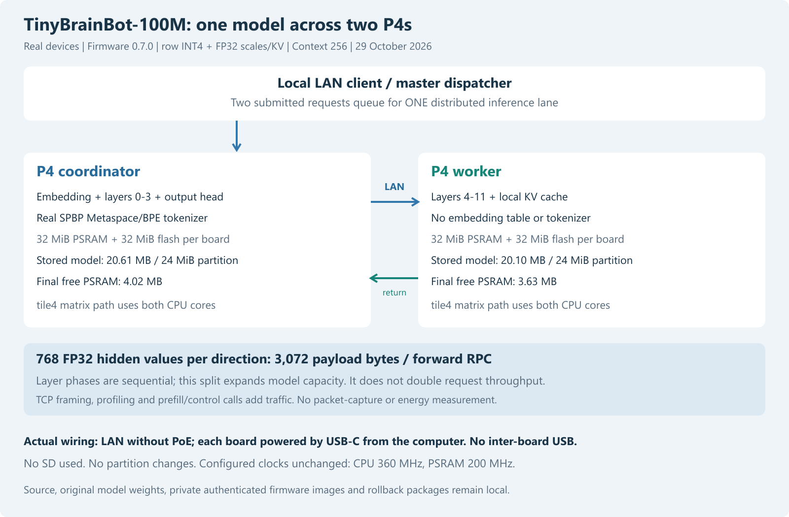
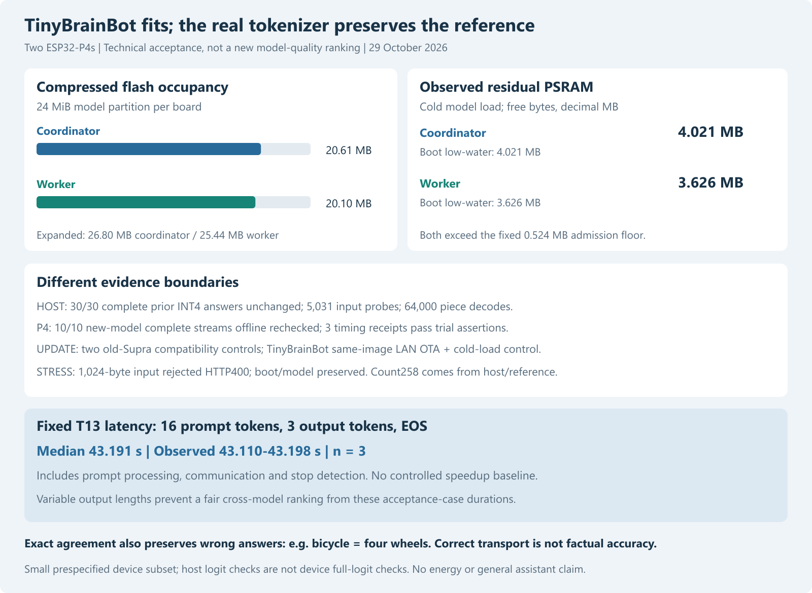

# TinyBrainBot: real Metaspace tokenizer and two-P4 acceptance

29 October 2026. Host acceptance and staged two-device LAN study completed.
No new weights or dependency installation. This extends the
[local model comparison](tinybrainbot-local-2026-10-29.md); it does not change
the selected checkpoint, row-INT4 quantizer or earlier answer-quality judgments.

## Target and contract

Pinned source: `nkthebass/tinybrainbot-100m-v3-instruct`, revision
`a8567bd7674f53b3fe5f42c8abaab35229a0e00e`, 100,092,672 parameters, original
author F16 Safetensors promoted to FP32 for export/reference computation.
All matrix weights remain symmetric row INT4, scales/norms/KV FP32. Context256,
full32000-token vocabulary, coordinator layers0–3 and worker layers4–11.
There is no change to partition layout, SD requirements or inter-board USB.

The new `SPBP0001` blob contains UTF8 vocabulary/offsets, ranked BPE merges,
added-token flags, Unicode scalar lookup, original precompiled normalization
table and derived Unicode16 grapheme/property ranges. It is1662968 bytes.
The envelope and model formats remain `P4QS0001` and lossless `P4ZL0001`.
Logical identity binds the actual tokenizer data, not a diagnostic placeholder.
Worker artifacts contain their eight layers and local KV, no tokenizer/table.

The independent bounded C implementation follows the **pinned tokenizers0.22.1
behavior**, including compatibility quirks. Algorithm sources:
[tokenizers0.22.1 Precompiled](https://github.com/huggingface/tokenizers/blob/v0.22.1/tokenizers/src/normalizers/precompiled.rs),
[Metaspace](https://github.com/huggingface/tokenizers/blob/v0.22.1/tokenizers/src/pre_tokenizers/metaspace.rs),
[spm_precompiled](https://github.com/huggingface/spm_precompiled),
[SentencePiece normalizer](https://github.com/google/sentencepiece/blob/master/src/normalizer.cc),
and [Unicode16 property tables](https://github.com/unicode-rs/unicode-segmentation/blob/v1.12.0/src/tables.rs).
The shipped Unicode data are derived from the MIT-licensed tables, with notice;
no Rust/regex/Unicode runtime is installed on the P4.

Encoding splits raw added tokens first, applies the original compiled map,
right-strip and repeated-space replacement, then matches normalized added tokens.
Metaspace prefixing respects original position; unknown symbols are fused per
pretoken as specified. Byte fallback is disabled: pseudo-byte vocabulary strings
remain literal decoder text. Invalid UTF8 and capacity excess return errors.
The C string API excludes embedded U+0000; host input limit4096 bytes, existing
HTTP prompt limit1024 bytes. These are explicit tested-domain bounds, not
a promise for arbitrary binary strings or all possible Unicode sequences.

Two reference quirks matter: short grapheme normalization uses the first trie
prefix result, and Metaspace drops all replacement markers in output token0.
Using current SentencePiece semantics or stripping only one leading marker
would not reproduce the pinned reference. A stateless output-index decoding
API keeps output token0 distinct from prompt token0 and preserves old decoder
behavior for the other formats.

## Host evidence

The [frozen export/acceptance protocol](../data/tinybrainbot-p4-2026-10-29/protocol.json)
and [host report](../data/tinybrainbot-p4-2026-10-29/host-report.json) record:

- All1,112,063 valid Unicode scalars except NUL/surrogates normalize identically
  to the existing Rust reference.
- 5031 input-ID comparisons: the fixed30 prompts, one full-width Unicode
  control and5000 seeded mixed Unicode/whitespace/added-token probes.
- All32000 vocabulary entries decode identically at output indices0 and1:
  64000 exhaustive piece comparisons in the tests.
- All30 previous complete candidate INT4 continuations match exactly in IDs,
  decoded text and EOS; wrong answers are retained unchanged.
- Five kernels, three positions each, full32000-logit comparison against
  source-layout NumPy: max absolute error0.0000438690, all argmaxes equal,
  bit-identical full/sharded and cross-kernel outputs on host.
- Both role KV caches filled sequentially through position255; position256
  rejected. Worker embedding and inappropriate layer ranges remain rejected.
- The native suite has81 passing tests, including malformed/truncated blobs,
  offset/merge/normalizer/range corruption, invalid UTF8, capacity guards and
  old-format regressions.

These are host results, not on-device full-logit or universal-text equivalence
proofs. Native full artifacts now contain the **real** tokenizer. The previous
fake-tokenizer diagnostics from the local comparison were not used for updates.

## Build/test correction provenance

The first ESP build rejected ambiguous indentation under GCC; the first
context-edge harness also incorrectly attempted to jump from position2 to255.
That rejection was correct API behavior, not a KV allocation failure. Both were
fixed before device acceptance. Original protocol and30 generation records were
preserved. [Correction patch](../data/tinybrainbot-p4-2026-10-29/source-correction.patch)
and [amendment](../data/tinybrainbot-p4-2026-10-29/host-amendment.json) retain before/
after hashes and the corrected sequential test.

The formatting-only native rebuild has identical executable/data/unwind/
relocation sections and layouts; only non-executable `.buildid` metadata differs.
That verified binary equivalence permits retaining the already completed30
generation records. Normalization/probes, numerical and corrected context checks
ran on the final binary. No historical protocol hash was silently replaced,
no answer/prompt changed and no compiler warning gate was disabled.

## Real flash and memory budget

| Role | Expanded artifact bytes | Tokenizer bytes | Stored compressed bytes | 24MiB partition |
|---|---:|---:|---:|---|
| Coordinator | 26,800,376 | 1,662,968 | 20,608,129 | Fits |
| Worker | 25,436,416 | 0 | 20,097,432 | Fits |

[Artifact hashes and identities](../data/tinybrainbot-p4-2026-10-29/model-artifacts.json)
include outer and inner checks. Compression changes flash occupancy only; each
role must still fit expanded weights, FP32 KV and runtime in its own32MiB PSRAM.
No model memory is pooled transparently across boards. Host wrapper round-trips
were checked before upload; the firmware verifies stored/expanded SHA and model
CRC, streams ROM zlib expansion into its final PSRAM allocation and validates
the real tokenizer on cold boot.

Firmware0.7.0 was built with the existing ESP-IDF5.5.4/rev1 toolchain for the
known P4 revision1.3 boards. Configured clocks remain360MHz CPU/200MHz PSRAM and
FreeRTOS1kHz, not externally measured. The private app image is806800 bytes and
remains local because it carries LAN authentication configuration. No serial
flasher, partition-table write or new software installation was used.

## Staged device protocol

The [installation protocol](../data/tinybrainbot-p4-2026-10-29/installation-protocol.json)
was fixed after host/build acceptance and before mutation. Both existing nodes
were checked idle with0.6.1/Supra and a verified private rollback image plus
genuine old model shards retained. Worker OTA first, then coordinator, each
followed by a distributed old-Supra ID/byte/EOS control. Both controls passed.
Only afterward were real TinyBrainBot worker/coordinator files installed.

Measured cold-load residual PSRAM is4,021,276 coordinator and3,626,016 worker
bytes, above the512KiB admission floor. These are observed readings, not the
earlier2MiB-reserve estimate. The worker reports no tokenizer and the coordinator
reports `metaspace_bpe`; both report the same logical model identity. Before and
after full device tests, free/largest/boot-low-water PSRAM and internal memory
are retained separately. Boot low-water includes initialization and networking;
it is not an isolated per-inference memory profiler.

Six prespecified native-template cases T03/T06/T13/A01/G02/K01 use cap16.
A two-job dispatcher pair T04/T09 must complete on the single distributed lane.
Three T13 timing repetitions use actual EOS lengths; they are fixed-request
latency observations, not a speedup comparison with another model. U01 tests
full-width W normalization. L01 is a1024-byte long-word input that encodes to258
tokens: it must be rejected before inference, while exercising encoder temporary
allocation and preserving the model/boot. Finally, same-image coordinator OTA
must reload the genuine tokenizer/model and repeat the distributed T13 control.

## Device results

All six direct cases match the prespecified native reference in token IDs,
UTF8 bytes and EOS. These are fixed-cap acceptance cases with different actual
lengths, not comparable throughput samples:

| Case | Prompt tokens | Output tokens | EOS | Total seconds | Time to first token (s) |
|---|---:|---:|---|---:|---:|
| T03 | 19 | 16 | False | 83.113 | 40.926 |
| T06 | 20 | 10 | True | 71.227 | 43.164 |
| T13 | 16 | 3 | True | 42.833 | 34.443 |
| A01 | 19 | 16 | False | 83.252 | 41.069 |
| G02 | 23 | 16 | False | 91.707 | 49.349 |
| K01 | 15 | 7 | True | 52.201 | 32.514 |

The dispatcher pair T04/T09 completed in order on the single distributed lane;
the second job started after the first finished. U01 and the post-OTA T13 also
match. In total the frozen trial asserted equality for **13 new-model device
generations**. Ten retain complete raw streams for offline token/byte/EOS
rechecking; the three timing repeats retain only their `done` profiles, so their
ID equality is a runtime assertion rather than an independently replayable raw
record. Two additional old-Supra controls retain complete raw streams.

T13 used 16 input tokens and stopped after three output tokens. Three repeat
latencies were 43.110, 43.191 and 43.198 seconds (median43.191; descriptive
observed range, no confidence interval). This includes prefill, transport and
stop detection. No matched new-model speed baseline was measured. The full
52,236,536-byte artifact already exceeds one board's32MiB PSRAM, before KV and
runtime; no one-P4 full-model execution or speedup is claimed.

### Memory, stress and final update

| Observation | Coordinator free / low-water bytes | Worker free / low-water bytes |
|---|---:|---:|
| Cold model load | 4,021,276 / 4,021,108 | 3,626,016 / 3,625,848 |
| After direct, queue and Unicode study | 3,685,396 / 3,667,936 | 3,626,016 / 3,625,848 |
| After oversized-context encoding | 3,685,396 / 3,482,632 | Not sampled in this step |
| After same-image OTA and control | 4,021,276 / 4,005,904 | 3,626,016 / 3,625,848 |

The coordinator's lowest sampled boot-low-water was3,482,632 bytes after the
long-input encoder stress; its free bytes returned to the pre-stress value.
The earlier change in coordinator free memory after queue use is recorded,
not assigned to a particular allocator without isolated profiling. Largest
blocks and internal-heap readings are retained in the raw receipts. These
observations establish fit for the bounded tested workload; they are not a
long-duration leak, fragmentation or concurrency qualification.

L01 returned HTTP400 with the expected context-overflow message, preserving
boot/model identity. Its recorded `input_token_count:258` is the expected
host/reference value, **not a token count returned by the device**. The separate
[long-input host receipt](../data/tinybrainbot-p4-2026-10-29/long-input-host.json)
confirms native C and Rust IDs agree for this1024-byte input. The actual device
observation is rejection and preserved readiness after temporary allocation.

Same-image coordinator OTA0.7.0 completed over authenticated LAN, boot identity
changed, the genuine model/tokenizer cold-loaded and the distributed T13 control
matched. The [final receipt](../data/tinybrainbot-p4-2026-10-29/final.json) records both
boards ready, correct distinct roles/artifacts, shared logical model ID, no
pending update, zero queued/running jobs. The worker remained loaded throughout.

## Interpretation and remaining boundaries

The missing deployment component is now implemented and tested: the earlier
local row-INT4 answer-quality result can actually be exercised on the two P4s.
This changes deployment evidence; it does not improve training or quantization.
The known bicycle answer still says four wheels. Small unblinded author-reviewed
question sets, familiar facts and possible training overlap remain the quality
limitations. No independent evaluator, third physical node, energy measurement,
packet capture, sustained-load qualification or general-assistant claim.

The model split increases capacity. Dependent layer execution over LAN remains
sequential per token, and both boards together serve one request at a time.
Independent-request throughput from the older replicated small models does not
transfer to this larger sharded model. Prompt processing is substantial; future
speed research should freeze equal workloads and measure prefill/decode and
local compute/RPC separately before changing kernels or split boundaries.

## Evidence, plots and reproduction

The [offline audit](../data/tinybrainbot-p4-2026-10-29/record-audit.json),
[device summary](../data/tinybrainbot-p4-2026-10-29/device-summary.json),
[build receipt](../data/tinybrainbot-p4-2026-10-29/build-receipt.json),
[source provenance](../data/tinybrainbot-p4-2026-10-29/reference-sources.json) and
figure sidecars separate measured records from author interpretation.

From the repository root, `python tools/verify_tinybrainbot_p4.py` rechecks stored
records and source hashes offline, without weights, native DLL or network.
`python tools/plot_tinybrainbot_p4.py` regenerates SVG/PNG from those records using
the already available Node/sharp renderer; this is a derived figure, not a new
hardware test. `tools/test.ps1` builds the native library and runs the local
suite; `tools/build.ps1 -Revision rev1` builds the ESP image with cached IDF.
Do not rebuild a DLL while a host study maps it.

For a fresh inference experiment, retain pinned local model/tokenizer assets,
prepare new output/private paths in a separately versioned copy of the trial,
freeze its protocol and run the host gates before any device writes. The archived
trial paths are intentionally fixed; `prepare` refuses incompatible completed
records, and `host-resume` is the documented historical correction path, not a
generic fresh-run command. Hardware stages mutate real devices and must be run
only against the intended idle targets with compatible rollback retained.
Restore genuine Supra model roles before downgrading to0.6.1, which cannot read
SPBP. Model storage is not A/B; firmware OTA is A/B.

No new model weights or dependencies downloaded for this port. Only small public
algorithm reference files were consulted; no project payload was sent online.
Private authenticated firmware, deployment states, model blobs and rollback
images remain excluded from Git. Journal and commits are local; no publication.
